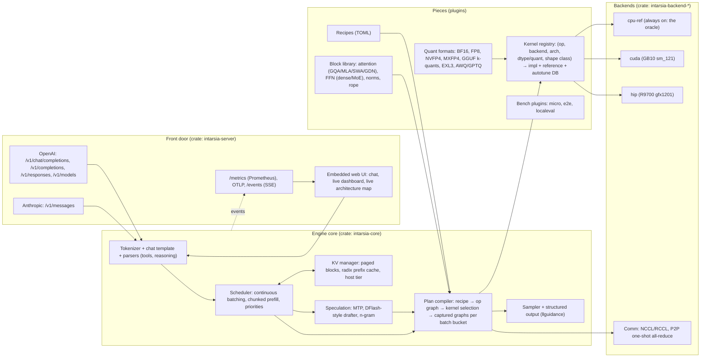

# IntarsiaML architecture plan (v0.2, 2026-10-12)

> v0.2 incorporates the [Fable adversarial review](reviews/2026-10-12-fable-adversarial-review.md): torch-free C kernel ABI, TensorFold (MIT) and radiance (Apache-2.0) as the first kernel packs, hard kernels earlier, Phase 0 cut to seams.

Intarsia is wood inlay: a picture built from interchangeable, precisely fitted pieces. The engine works the same way. Every op, kernel, quant format, model block, benchmark and API surface is a piece with a contract, and every piece is checked against a reference before it is allowed in.

Research this plan builds on: [AMD R9700 lessons](research/amd-r9700-lessons.md), [Spark / TensorFold / tooling lessons](research/spark-tensorfold-tooling-lessons.md), [Fable review](reviews/2026-10-12-fable-adversarial-review.md). Decisions are logged in [decisions/](decisions/).

> **Status of this document (2026-10-25).** This file is the v0.2 *plan*, not a description of the code. Each claim in
> sections 1 to 14 now carries one of three markers, checked against `origin/main` with `grep` and `ls`
> (review finding 7, [reviews/2026-10-22-fable-adversarial.md](reviews/2026-10-22-fable-adversarial.md)):
> **implemented** (links to the file that does it), **partial** (says what is missing) or **planned** (nothing in the code yet).
> Where the code does the job differently from the text, the row says so and the original text is left as the design intent.
> The "Status vs plan" table below and the section 13 status paragraph were re-checked on 2026-10-25 against `origin/main`
> (e5af0a15, PRs up to #155). The per-section tables (1 to 12) and the section 2 diagram note were last checked on 2026-10-22
> (cd617de2) and may lag the table below.

### Status vs plan

| Component | Status | Short version |
|---|---|---|
| Rust host, server, CLI, TUI, embedded UI | **implemented** | 12 crates; see sections 1, 9, 12 |
| Backends: cpu-ref, CUDA, HIP | **implemented** | cpu-ref is the oracle; CUDA targets `sm_121`, HIP `gfx1201` |
| Metal backend | **implemented** | not in the plan above; `crates/intarsia-backend-metal`; row-exact batched decode for the hybrid 35B (`crates/intarsia-backend-metal/tests/rows_exact.rs`) |
| Vulkan / SYCL backend behind the same trait | **planned** | no code; the C ABI is CUDA-stream-shaped, so it is not "the same trait" for free |
| Backend trait | **partial** | exists, but shaped differently from the sketch (3.1) |
| Kernel registry, cpu-ref oracle, admission test | **implemented** | 3.2 |
| `register_kernel!` as the registration path | **partial** | macro exists, backends register through `KernelImpl` directly |
| Exactness modes (`fast`, `deterministic`, `exact`) | **implemented** | enum and per-kernel tag; no server flag |
| Autotuner and tuning DB (`tuning/<fingerprint>.toml`) | **planned** | no code, no `tuning/` directory; kernel choice is static priority |
| Torch-free C kernel ABI | **implemented** | `kernels/abi/ik_abi.h` |
| Kernel packs (`kernels/packs/*`) | **partial** | kernels are ported into `kernels/cuda` and `kernels/hip`; no pack mechanism, no submodules |
| Quant formats BF16, FP8, NVFP4, MXFP4, EXL3 | **implemented** | `crates/intarsia-core/src/quant` |
| Quant formats GGUF k-quants, AWQ/GPTQ | **planned** | no loader |
| `intarsia-quant` crate | **planned** | does not exist; formats live in `intarsia-core` |
| Block library (GQA, GDN, dense FFN, MoE, RMSNorm) | **partial** | hard-coded in Rust, selected by recipe; sliding window exists only inside the Gemma 4 block (`crates/intarsia-core/src/model/gemma.rs`); MLA, Mamba2, LayerNorm absent |
| Recipes and `recipe new` | **partial** | 7 recipes in `recipes/` (Qwen2, Qwen3, Qwen3.5 dense / MoE / VL, Llama, Gemma 4), so "Qwen3 family only" no longer holds; unsupported architectures refused at load |
| Plan compiler, `plan show`, measured-memory KV, graph capture | **partial** | graphs are captured per batch row count for batched decode (`crates/intarsia-core/src/model/graph_step.rs`); no tuning DB, no `--allow-slow` |
| Scheduler | **partial** | FIFO continuous batching (`crates/intarsia-core/src/scheduler.rs`) on Metal, CUDA and HIP for hybrid models; HIP dense models, tensor-parallel batching and MTP under batching are not on main; no priorities |
| Watchdog and supervisor | **implemented** | `crates/intarsia-server/src/supervisor.rs` |
| Paged KV blocks | **planned** | KV is contiguous per slot |
| Radix-tree prefix cache | **partial** | opt-in content-addressed prefix store (`crates/intarsia-core/src/prefix_store.rs`, `serve --prefix-store`, hash-keyed pages, not a radix tree), single-sequence engine only; idle-slot prefix reuse with recurrent snapshots otherwise |
| Host-RAM KV tier | **partial** | the prefix store keeps prefix pages in host memory and on disk (`crates/intarsia-core/src/prefix_store.rs`); live per-slot KV has no host tier |
| Speculation | **partial** | n-gram and the MTP drafter (`--spec mtp`, one sequence, greedy; captured draft+verify step on HIP in `crates/intarsia-core/src/model/spec_graph.rs`); DFlash absent; batched MTP refused at load (`crates/intarsia-models/src/load.rs`) |
| Sampler and structured output | **partial** | no min-p or penalties; `llguidance` is in |
| Tool and reasoning parsers | **partial** | one tool-call format (hermes) and one reasoning format (think-tags) |
| Tensor parallelism and `Comm` | **partial** | NCCL (CUDA), 2-rank P2P (HIP), host-bounced for the rest; no RCCL, no fused all-reduce+norm+quant, no lossy transports; batching under tp, vocab-parallel head and fused all-reduce+norm are open PRs, not on main |
| Accuracy system | **partial** | `intarsia accuracy` and `qualify`; gates differ from section 6 (see ADR-0008) |
| Bench plugins, onboarding | **partial** | `bench speed` and `onboard` exist; no `BenchPlugin` trait, no `micro` plugin |
| OpenAI and Anthropic APIs | **partial** | `/v1/responses` and `/v1/embeddings` absent |
| Prometheus metrics | **implemented** | OTLP export absent |
| Containers, run manifest, `intarsia replay` | **partial** | script-level only: `scripts/deploy.sh`, `scripts/bench-bundle.sh` (pack / replay), `scripts/repro-build.sh`, CI `scripts/repro-check.sh`; only HIP dev Dockerfiles (`deploy/tatooine/`); no manifest or `intarsia replay` command |

---

## 0. Goals, honest targets, anti-goals

Requirements in priority order (user, 2026-10-12): modular → easy to use → accurate → fast (top 3 per platform) → reproducible → OpenAI/Anthropic APIs → built-in UI/TUI (optional, dark) → metrics → live architecture diagram → Spark → R9700 → TP=X → Intel Arc later.

**What "top 3" means per platform** (the competitor to beat at each phase gate):

| Platform | Current leaders on our boxes | Phase-2 gate | Phase-4 gate |
|---|---|---|---|
| DGX Spark (GB10) | TensorFold (27B EXL3+DFlash2 83 tok/s), vLLM (35B-A3B NVFP4 86-90), llama.cpp, SGLang | beat llama.cpp and vLLM single-stream on the same quant | within 10% of TensorFold |
| R9700 (gfx1201) | native radiance (27B TP=2 207-226), vLLM-radiance (150), llama.cpp Vulkan (MoE 112) | beat llama.cpp Vulkan/HIP | beat vLLM-radiance; radiance is the long-term bar |
| Apple Silicon (dev box) | mlx-serve, MLX-LM, TensorFold-MLX | correctness only | later decision |
| Intel Arc | llama.cpp SYCL | not in scope | not in scope |

Top 3 on R9700 means beating vLLM or llama.cpp, not radiance, until Phase 4. Saying so keeps the target honest.

**Anti-goals** (each one cost a prior project months):
- **No per-family engines.** TensorFold ships a CUDA engine per model family; effort multiplies per model. Here a model is a *recipe* over a shared block library. New code is needed only for a genuinely new block type.
- **No Python in the serving path.** Native radiance starts in 11 s vs 160 s for vLLM at equal or better step time. Python stays in offline tools (golden references, converters).
- **No scope sprawl.** Text LLM inference first. No image, audio or 3D (mlx-serve's burden). Vision encoders are a later block type, not a side product.
- **No kernel enters without passing its reference test.** sm_121 CUTLASS NVFP4 MoE emitting `!!!!!` and a cuDNN FP8 GEMM hanging after 250k steps were both shipped by others.

---

## 1. Language and build

| Layer | Choice | Why |
|---|---|---|
| Host: server, scheduler, KV manager, loaders, metrics, UI server, CLI | **Rust** (stable, edition 2021) | Native speed and startup with memory safety; best ecosystem for this exact stack: `tokenizers` (HF), `safetensors`, `minijinja` (HF chat templates), `llguidance` (structured output), `axum`/`tokio`, `ratatui`, `prometheus-client`, `opentelemetry`, `cudarc` (CUDA driver + NCCL). One static binary per platform. |
| GPU kernels, NVIDIA | **CUDA C++** (+ inline PTX where profiling demands), AOT-compiled to fatbins for `sm_121` (GB10), plus `sm_90/100/120` when hardware appears | Cold JIT compiles take minutes on GB10; AOT removes that. |
| GPU kernels, AMD | **HIP C++** (+ inline GCN/RDNA asm where needed), AOT for `gfx1201` | Same as radiance, which holds the R9700 bar. |
| Shared kernel code | One `ik_portable.h` header that maps CUDA/HIP intrinsics; elementwise, norm, rope, sampling and quant-pack kernels compile from one source for both | Halves the simple-kernel work. GEMM and attention stay arch-specific. |
| Apple (dev) / Arc (later) | Metal / Vulkan or SYCL backends behind the same trait | Not built now; the trait is shaped so they slot in. |
| Offline tools | Python (uv), never imported by the server | Golden logits via HF `transformers`, plotting, converters. |

Rejected: C++ host (radiance proves it works, but modularity, packaging and the server/UI ecosystem are slower to build); Zig host (mlx-serve proves it works, but the ML-adjacent library ecosystem is thin; no `tokenizers`/`llguidance` equivalents); Python host (per-step overhead, startup, container weight); Mojo (tried in `TensorFold-mojo*`, not merged). Assembly is used per hot spot, not as a language choice.


**Status (section 1).**

| Claim | Status | Evidence on origin/main |
|---|---|---|
| Rust host, one binary per platform | **implemented** | [`Cargo.toml`](../Cargo.toml) workspace, edition 2021, `rust-toolchain.toml` pins 1.90.0 |
| Host crates `tokenizers`, `minijinja`, `llguidance`, `axum`, `ratatui` | **implemented** | [`Cargo.toml`](../Cargo.toml) dependencies |
| Host crates `prometheus-client`, `opentelemetry`, `cudarc`, `rust-embed` | **planned** | not in `Cargo.toml`: metrics are hand-written ([`crates/intarsia-server/src/metrics.rs`](../crates/intarsia-server/src/metrics.rs)), CUDA is bound through own FFI ([`crates/intarsia-backend-cuda/src/ffi.rs`](../crates/intarsia-backend-cuda/src/ffi.rs)), UI files are `include_str!`d ([`crates/intarsia-ui/src/lib.rs`](../crates/intarsia-ui/src/lib.rs)) |
| CUDA C++ AOT for `sm_121` | **implemented** | [`crates/intarsia-backend-cuda/build.rs`](../crates/intarsia-backend-cuda/build.rs) (default `sm_121`) |
| HIP C++ AOT for `gfx1201` | **implemented** | [`crates/intarsia-backend-hip/build.rs`](../crates/intarsia-backend-hip/build.rs) (default `gfx1201`) |
| One `ik_portable.h` so simple kernels compile from one source for CUDA and HIP | **partial** | [`kernels/common/ik_portable.h`](../kernels/common/ik_portable.h) exists, but `kernels/cuda/*.cu` and `kernels/hip/*.hip` are separate files |
| Apple (dev) / Arc (later): Metal / Vulkan or SYCL behind the same trait | **partial** | Metal **implemented**: [`crates/intarsia-backend-metal/src/lib.rs`](../crates/intarsia-backend-metal/src/lib.rs); Vulkan/SYCL **planned**: no code |
| Offline Python tools, never imported by the server | **implemented** | [`tools/golden.py`](../tools/golden.py), [`tools/scribe.py`](../tools/scribe.py) |

---

## 2. System overview



**Status (section 2 diagram).** Boxes that are **planned** or **partial**: `KV` ("paged blocks, radix prefix cache, host tier"; planned, KV is contiguous per slot), `SPEC` (partial: n-gram only), `QF` (partial: no GGUF k-quants, AWQ/GPTQ), `BLK` (partial: no MLA, sliding window, Mamba2), `KR` "autotune DB" (planned), `HIP` and `CUDA` are implemented, `COMM` "NCCL/RCCL" (partial: no RCCL), "OTLP" in `MET` (planned), `/v1/responses` in `OAI` (planned), `PLAN` "captured graphs per batch bucket" (partial, see 3.6). Metal is implemented but missing from the diagram. The picture in [architecture-diagram.md](architecture-diagram.md) marks planned components with dashed outlines.

---

## 3. Core abstractions (the pieces)

### 3.1 Backend trait (minimal on purpose)

```rust
pub trait Backend: Send + Sync {
    fn info(&self) -> DeviceInfo;                       // arch, mem, bandwidth (measured), features
    fn alloc(&self, bytes: usize, kind: MemKind) -> Result<Buffer>;
    fn copy(&self, dst: &Buffer, src: &Buffer, stream: StreamId) -> Result<()>;
    fn launch(&self, k: &LoadedKernel, args: &KernelArgs, stream: StreamId) -> Result<()>;
    fn graph_begin(&self, stream: StreamId) -> Result<()>;
    fn graph_end(&self, stream: StreamId) -> Result<GraphHandle>;
    fn graph_replay(&self, g: &GraphHandle, stream: StreamId) -> Result<()>;
    fn event(&self, stream: StreamId) -> Result<Event>;
    fn comm(&self) -> Option<&dyn Comm>;                 // TP collectives
}
```


**Status (3.1).**

| Claim | Status | Evidence on origin/main |
|---|---|---|
| A minimal `Backend` trait is the whole device contract | **partial** | [`backend.rs:165`](../crates/intarsia-core/src/backend.rs): the trait exists with 23 methods, 9 required (`name`, `info`, `alloc`, `upload`, `download`, `copy`, `kernels`, `launch`, `synchronize`); the rest have defaults. Shape differs from the sketch: `launch` is `launch(kernel_name, &OpCall, stream)`, graphs are `graph_capture`/`graph_replay`, there is no `event` |
| `fn comm(&self) -> Option<&dyn Comm>` | **partial** | no `comm` method on the trait; TP collectives are built from backend lists in [`crates/intarsia-core/src/comm.rs`](../crates/intarsia-core/src/comm.rs) and per-backend files |
| Everything above the trait is backend-neutral | **partial** | backend-specific branches remain: [`crates/intarsia-core/src/model/batch.rs`](../crates/intarsia-core/src/model/batch.rs) tests `backend.name() != "cpu"`, and `--max-batch` is Metal-only in [`crates/intarsia-models/src/load.rs`](../crates/intarsia-models/src/load.rs) |
| A Vulkan or SYCL backend only has to implement the trait plus its kernel packs | **planned** | no such backend; `kernels/abi/ik_abi.h` takes a CUDA-stream-shaped `void* stream` and CUDA/HIP share `ik_*` symbol names |
| Backend init applies known-bad-default fixes as data (`GPU_MAX_HW_QUEUES=1`) | **partial** | applied by the launchers, not by backend init: [`crates/intarsia-cli/src/cmd/onboard.rs`](../crates/intarsia-cli/src/cmd/onboard.rs), [`crates/intarsia-cli/src/cmd/qualify.rs`](../crates/intarsia-cli/src/cmd/qualify.rs); `doctor` only reports it ([`crates/intarsia-cli/src/cmd/doctor.rs`](../crates/intarsia-cli/src/cmd/doctor.rs)) |


Everything else (ops, quant, attention) lives above the trait. A Vulkan or SYCL backend for Arc only has to implement this plus its kernel packs. Backend init applies known-bad-default fixes as data (for example `GPU_MAX_HW_QUEUES=1` on HIP, which removed a permanent 20% slowdown).

### 3.2 Kernel registry: the core of modularity and accuracy

Every **op** (e.g. `matmul`, `rmsnorm_add`, `rope`, `paged_attn_decode`, `paged_attn_verify`, `moe_gate_topk`, `moe_grouped_gemm`, `all_reduce_norm_quant`) has:

1. A **signature**: typed inputs/outputs, layouts, quant format.
2. A **reference implementation** in `cpu-ref` (f32/f64 accumulate). This is the oracle.
3. Any number of **implementations**, each declaring `(backend, arch set, dtype/quant, shape predicate, exactness class)`.

```rust
register_kernel! {
    op: Matmul, name: "nvfp4_gemv_splitk_v1",
    backend: Cuda, arch: [sm_121], weights: Nvfp4, acts: [Bf16, Fp8E4m3],
    when: |s| s.m <= 8 && s.k % 64 == 0,          // shape preconditions are code, checked at plan time
    exact: Exactness::Deterministic,               // or BitExactVsSerial / Tolerance(...)
    tol: Tol { max_abs: 2e-2, rel_l2: 5e-3 },
}
```

Rules:
- **Admission test**: `intarsia kernels test` runs every registered implementation against its reference over a shape sweep (including the recipe's real shapes) and records pass/fail plus error stats. A kernel that fails is unselectable on that host. This catches the "compiles for sm_120 but runs garbage on sm_121" class.
- **Plan-time preconditions**: shape predicates are evaluated when the plan is built, so traps like "MXFP4 GEMM needs per-rank K % 128" fail loudly at load, not as token-0 output.
- **Autotuner**: for each (op, shape bucket) on a host, time the eligible implementations and store the winner in a **tuning DB** keyed by host fingerprint (GPU, driver, toolkit, kernel-pack hash). The DB is a committed lockfile per platform (`tuning/<fingerprint>.toml`) so results reproduce.
- **Exactness modes** (from TensorFold): `fast` (any passing kernel), `deterministic` (fixed reduction order, run-to-run identical), `exact` (multi-row verify equals serial decode bit-for-bit; required for lossless speculation claims). Mode is a server flag and is reported in every result.


**Status (3.2).**

| Claim | Status | Evidence on origin/main |
|---|---|---|
| Every op has a typed signature | **implemented** | [`crates/intarsia-core/src/ops.rs`](../crates/intarsia-core/src/ops.rs): `Op` enum, 38 ops with arity and shape checks. The example op names (`paged_attn_decode`, `paged_attn_verify`, `moe_gate_topk`, `moe_grouped_gemm`, `all_reduce_norm_quant`) are plan names; the real ones are `AttnDecode`, `AttnPrefill`, `MoeTopk`, `MoeExperts`, `MoeBlock`, and there is no all-reduce op |
| Reference implementation per op in `cpu-ref` | **implemented** | [`crates/intarsia-backend-cpu/src/reference.rs`](../crates/intarsia-backend-cpu/src/reference.rs) |
| Many implementations per op, each with (backend, arch, dtype/quant, shape predicate, exactness) | **implemented** | [`crates/intarsia-core/src/registry.rs`](../crates/intarsia-core/src/registry.rs) `KernelImpl` |
| `register_kernel!` macro | **partial** | [`registry.rs:217`](../crates/intarsia-core/src/registry.rs) defines it; only that file uses it. Backends build `KernelImpl` values directly ([`crates/intarsia-backend-cuda/src/kernels.rs`](../crates/intarsia-backend-cuda/src/kernels.rs)). The `tol:` field in the example is illustrative |
| Admission test, `intarsia kernels test`; failing kernel is unselectable | **implemented** | [`crates/intarsia-core/src/admission.rs`](../crates/intarsia-core/src/admission.rs), [`crates/intarsia-cli/src/cmd/kernels.rs`](../crates/intarsia-cli/src/cmd/kernels.rs) |
| Plan-time preconditions fail loudly at load | **implemented** | [`crates/intarsia-core/src/plan.rs`](../crates/intarsia-core/src/plan.rs) returns `Error::NoKernel` when no admitted kernel fits |
| Autotuner and tuning DB committed as `tuning/<fingerprint>.toml` | **planned** | no autotuner code and no `tuning/` directory; selection is static priority among admitted kernels |
| Exactness modes `fast`, `deterministic`, `exact` | **implemented** | [`registry.rs:16`](../crates/intarsia-core/src/registry.rs) `Exactness` enum, shown by `intarsia kernels` |
| Mode is a server flag reported in every result | **planned** | no `--exactness` flag in `serve` or `common.rs`; exactness is a per-kernel tag |

### 3.3 Kernel ABI and kernel packs

Every pack is a **port**, not an import (most upstream kernels take `torch::Tensor`). The port target is one torch-free C ABI, `kernels/abi/ik_abi.h`:

```c
typedef struct { void* data; int32_t dtype; int32_t ndim; int64_t shape[6]; int64_t stride[6]; } ik_tensor;
typedef struct { const void* scales; const void* zeros; int32_t group; int32_t format; } ik_quant;
// every launcher: raw tensors in, status out, explicit stream, no allocation inside
int ik_rmsnorm_add(const ik_tensor* x, const ik_tensor* res, const ik_tensor* w, float eps, ik_tensor* out, void* stream);
```

Kernels are compiled by `nvcc`/`hipcc` into a static library per backend and bound from Rust via `extern "C"`. The same shim pattern covers HIP, where Rust bindings are thin (no RCCL or hipBLASLt crates).

| Pack | Backend | License | Port first |
|---|---|---|---|
| `native` (ours) | CUDA + HIP | Apache-2.0 | norms, rope, embedding, sampling, simple attention, glue |
| `tensorfold` | CUDA (+ its ROCm variants) | MIT | EXL3 linear/experts, NVFP4 `qmmf`, GDN, DFlash verify, attention: holds the Spark bar |
| `radiance` (`libr4d`) | HIP gfx1201 | Apache-2.0 (keep `NOTICE`) | MXFP4×FP8 GEMM, one-shot 2/3-rank all-reduce (+norm+quant), GDN recurrent update, paged attention, int2 lm_head: holds the R9700 bar |
| `cublaslt` / `hipblaslt` | vendor | vendor | prefill GEMM, registered as `Exactness::Fast` only (algorithm choice varies by shape; graphs freeze one) |

Other packs (flashinfer, cutlass, ggml, exl3 upstream, ck/aiter) are added only when a measured gap names one. Rule: **no pack is vendored without its license file in `LICENSES/`**, pinned by commit, and every exported kernel passes the admission test.

**Block-scope fused ops are first-class.** Radiance and TensorFold are fast because of hand-fused, family-specific kernels (all-reduce in a GEMV epilogue, norm+quant into GDN). A generic pattern-rewriting fuser is a compiler project we will not build. Instead the registry holds fused block ops (e.g. `gdn_layer_decode_fused`, `attn_block_decode_fused`, `all_reduce_rmsnorm_fp8`) whose reference is the generic op chain. The plan compiler picks the fused op when one is admitted for the shape, else falls back to the chain.


**Status (3.3).**

| Claim | Status | Evidence on origin/main |
|---|---|---|
| One torch-free C ABI, `kernels/abi/ik_abi.h` | **implemented** | [`kernels/abi/ik_abi.h`](../kernels/abi/ik_abi.h) (`ik_tensor`, `ik_quant`; launcher comment still says Phase 0 dense BF16) |
| Kernels compiled by `nvcc`/`hipcc` into a static library and bound via `extern "C"` | **implemented** | [`crates/intarsia-backend-cuda/build.rs`](../crates/intarsia-backend-cuda/build.rs), [`crates/intarsia-backend-hip/build.rs`](../crates/intarsia-backend-hip/build.rs), FFI in `ffi.rs` of each crate |
| `native` pack (ours, CUDA + HIP) | **implemented** | [`kernels/cuda`](../kernels/cuda), [`kernels/hip`](../kernels/hip) |
| `tensorfold` pack (MIT): EXL3, NVFP4, GDN, DFlash verify | **partial** | ports of TensorFold kernels exist ([`kernels/cuda/exl3.cu`](../kernels/cuda/exl3.cu), [`kernels/cuda/nvfp4.cu`](../kernels/cuda/nvfp4.cu), licence in [`LICENSES/TensorFold-MIT.txt`](../LICENSES/TensorFold-MIT.txt)); there is no pack boundary, and no DFlash verify |
| `radiance` pack (Apache-2.0): MXFP4xFP8 GEMM, one-shot all-reduce, GDN, paged attention | **partial** | HIP kernels with attribution ([`kernels/hip/NOTICE-radiance`](../kernels/hip/NOTICE-radiance), [`LICENSES/Apache-2.0-radiance.txt`](../LICENSES/Apache-2.0-radiance.txt), [`kernels/hip/allreduce.hip`](../kernels/hip/allreduce.hip)); no paged attention |
| `cublaslt` / `hipblaslt` prefill GEMM registered as `Fast` | **partial** | cuBLASLt for FP8 only ([`kernels/cuda/fp8_gemm_lt.cu`](../kernels/cuda/fp8_gemm_lt.cu)); hipBLASLt is referenced from [`kernels/hip/matmul.hip`](../kernels/hip/matmul.hip) |
| Other packs (flashinfer, cutlass, ggml, exl3, ck/aiter) as pinned submodules under `kernels/packs/` | **planned** | no `kernels/packs/`, no `.gitmodules` |
| No pack vendored without its licence file in `LICENSES/` | **implemented** | [`LICENSES`](../LICENSES) holds radiance, TensorFold and exllamav3 |
| Block-scope fused ops are first-class; plan picks the fused op when admitted, else the chain | **partial** | fused ops exist as `Op` variants (`MoeBlock`, `GdnConvDelta`, `RmsNormAddMatmulPair`, `QkNormRopeKv`, ... in [`crates/intarsia-core/src/ops.rs`](../crates/intarsia-core/src/ops.rs)); the example names (`gdn_layer_decode_fused`, `attn_block_decode_fused`, `all_reduce_rmsnorm_fp8`) do not exist, and the chain fallback is decided in model code, not by the plan compiler |

### 3.4 Quant formats as plugins

```rust
pub trait QuantFormat {
    fn id(&self) -> QuantId;                                  // "nvfp4", "mxfp4", "gguf:q4_k", "exl3:3.0", ...
    fn detect(&self, meta: &WeightMeta) -> bool;              // from safetensors/GGUF metadata
    fn load(&self, src: &TensorSource, dst: &dyn Backend, layout: &Layout) -> Result<QTensor>;
    fn dequant_ref(&self, q: &QTensor) -> Tensor;             // used by the oracle
    fn quantize(&self, t: &Tensor, cfg: &QuantCfg) -> Option<QTensor>;  // optional: on-the-fly RTN
}
```

Adding a quant = implement this trait + register matmul kernels that accept it. The oracle path (`dequant_ref` + reference matmul) works the moment `load` and `dequant_ref` exist, so correctness is testable before any fast kernel is written.

Per-tensor overrides live in the recipe (e.g. drafter stays FP8: MXFP4 RTN dropped drafter acceptance from 2.5 to 2.21 on R9700).


**Status (3.4).**

| Claim | Status | Evidence on origin/main |
|---|---|---|
| `QuantFormat` trait with `id`, `detect`, `load`, `dequant_ref`, `quantize` | **implemented** | [`mod.rs:213`](../crates/intarsia-core/src/quant/mod.rs) (same five methods; `load` takes `WeightMeta`, `&dyn Backend` and `QuantLoadOpts`) |
| Formats BF16, FP8, NVFP4, MXFP4, EXL3 | **implemented** | [`crates/intarsia-core/src/quant/fp8.rs`](../crates/intarsia-core/src/quant/fp8.rs), [`crates/intarsia-core/src/quant/nvfp4.rs`](../crates/intarsia-core/src/quant/nvfp4.rs), [`crates/intarsia-core/src/quant/mxfp4.rs`](../crates/intarsia-core/src/quant/mxfp4.rs), [`crates/intarsia-core/src/quant/exl3.rs`](../crates/intarsia-core/src/quant/exl3.rs); BF16 is `Bf16Dense` in `quant/mod.rs` |
| Formats GGUF k-quants, AWQ/GPTQ | **planned** | no `QuantFormat` impl; `gguf` appears only in `quant/scheme.rs` and `cmd/recipe.rs` text |
| Adding a quant = implement the trait + register kernels | **partial** | also needs `Op` variants per (format, fusion) and edits in about 20 files (review finding 9, deferred to the user) |
| Oracle path works as soon as `load` and `dequant_ref` exist | **implemented** | [`crates/intarsia-core/src/quant/reference.rs`](../crates/intarsia-core/src/quant/reference.rs) |
| Per-tensor overrides live in the recipe | **partial** | recipes carry per-backend tuning tables; per-tensor quant overrides are chosen in load code, not in the recipe TOML |
| `intarsia-quant` crate (section 12) | **planned** | does not exist; code is under [`crates/intarsia-core/src/quant`](../crates/intarsia-core/src/quant) |

### 3.5 Block library and recipes: adding a model

A **block** is a reusable layer piece with a typed config: `Attention{kind: Gqa|Mla|SlidingWindow|GatedDeltaNet|Mamba2, rope: ..., qk_norm: bool}`, `Ffn{kind: Dense|Moe{experts, top_k, shared, router}}`, `Norm{RmsNorm|LayerNorm, offset}`, `Embedding`, `LmHead{tied}`.

A **recipe** maps a Hugging Face model to blocks:

```toml
# recipes/qwen3.toml
[model]
match.architectures = ["Qwen3ForCausalLM"]
family = "qwen3"
chat_template = "hf"            # use tokenizer_config.json template via minijinja
reasoning_parser = "think-tags"
tool_parser = "hermes"

[layer]                          # applied to every layer i
pattern = ["attn", "ffn"]
attn = { kind = "gqa", q = "model.layers.{i}.self_attn.q_proj", k = "...k_proj", v = "...v_proj",
         o = "...o_proj", q_norm = "...q_norm", k_norm = "...k_norm", rope = "default" }
ffn  = { kind = "dense", act = "silu_glu", gate = "model.layers.{i}.mlp.gate_proj",
         up = "...up_proj", down = "...down_proj" }
norms = { pre_attn = "model.layers.{i}.input_layernorm", pre_ffn = "model.layers.{i}.post_attention_layernorm" }

[top]
embed = "model.embed_tokens"
final_norm = "model.norm"
lm_head = { tensor = "lm_head", tied_to = "model.embed_tokens" }

[defaults]                       # tunables a user can override per deployment
kv_dtype = "bf16"                # fp8_e4m3 KV is opt-in (CUDA `--kv-dtype fp8_e4m3`), not a recipe default
max_batch = 8                    # ceiling for the batching scheduler (Metal only); the qwen3_5* recipes declare 32. `serve` runs one sequence unless --max-batch N (2..8; ADR-0010)

[tuning.metal]                   # optional per-backend prefill chunk (--prefill-chunk wins; unlisted backends use 256)
prefill_chunk = 2048

[tuning.hip]
prefill_chunk = 2048             # qwen3_5_moe.toml: CUDA 2048, HIP 4096
```

Updated 2026-10-21: this example (it mirrors `recipes/qwen3.toml`) used to show `kv_dtype = "fp8_e4m3"`, `max_batch = 32` and no tuning table. Every shipped recipe (`recipes/*.toml`) uses `bf16`; the current defaults are tabulated in [docs/decisions/LOG.md](decisions/LOG.md) ("Defaults in force on main").

Hybrid models (Qwen3.5/3.8 GDN + full attention every 4th layer) use `pattern_by_layer` or a `layer_types` key read from `config.json`. `intarsia recipe new <hf-dir>` inspects `config.json` + tensor names, matches the closest existing recipe, writes a draft, and lists unmapped tensors. Most new models in a known family need only a recipe; new block types are the only code.


**Status (3.5).**

| Claim | Status | Evidence on origin/main |
|---|---|---|
| `Attention` kind Gqa | **implemented** | [`recipes/qwen3.toml`](../recipes/qwen3.toml) (`kind = "gqa"`) |
| `Attention` kind GatedDeltaNet | **implemented** | [`recipes/qwen3_5.toml`](../recipes/qwen3_5.toml) (`kind = "gated_delta_net"`), [`crates/intarsia-core/src/gdn.rs`](../crates/intarsia-core/src/gdn.rs) |
| `Attention` kinds Mla, SlidingWindow, Mamba2 | **planned** | no such kind in [`recipes`](../recipes) or the model code; a `sliding_attention` layer type is rejected in [`crates/intarsia-models/src/recipe.rs`](../crates/intarsia-models/src/recipe.rs) |
| `Ffn` kind Dense | **implemented** | [`recipes/qwen3.toml`](../recipes/qwen3.toml) |
| `Ffn` kind Moe | **implemented** | [`recipes/qwen3_5_moe.toml`](../recipes/qwen3_5_moe.toml) (`kind = "qwen3_5_moe"`), [`crates/intarsia-core/src/quant/moe.rs`](../crates/intarsia-core/src/quant/moe.rs) |
| `Norm` RmsNorm | **implemented** | [`crates/intarsia-core/src/ops.rs`](../crates/intarsia-core/src/ops.rs) `RmsNorm` |
| `Norm` LayerNorm | **planned** | no LayerNorm op |
| Blocks are a reusable typed-config library | **partial** | block structure is Rust code in [`crates/intarsia-core/src/model.rs`](../crates/intarsia-core/src/model.rs); a recipe selects and wires tensors but cannot define a new block |
| Recipe maps a Hugging Face model to blocks | **implemented** | [`recipes`](../recipes) (qwen3, qwen3_5, qwen3_5_moe, qwen3_5_vl), loaders [`crates/intarsia-models/src/recipe.rs`](../crates/intarsia-models/src/recipe.rs), [`crates/intarsia-core/src/recipe.rs`](../crates/intarsia-core/src/recipe.rs) |
| Hybrid models via `pattern_by_layer` or `layer_types` | **implemented** | [`crates/intarsia-models/src/recipe.rs`](../crates/intarsia-models/src/recipe.rs) (tests show `layer_types`) |
| `intarsia recipe new <hf-dir>` drafts a recipe and lists unmapped tensors | **implemented** | [`crates/intarsia-cli/src/cmd/recipe.rs`](../crates/intarsia-cli/src/cmd/recipe.rs) |
| Most new models in a known family need only a recipe | **partial** | true inside the Qwen3 family only; rope scaling variants (llama3, yarn, longrope), attention bias, sliding window, non-SiLU FFNs need code or are refused at recipe load ([`docs/adding-a-model.md`](../docs/adding-a-model.md)) |

### 3.6 Plan compiler

`recipe + config + weights + host` → **plan**:
1. Build the op graph for one decode step and one prefill chunk.
2. Prefer admitted block-scope fused ops (3.3) over their generic op chains; only trivial load-time rewrites (`gate+up` weight concat, QKV concat).
3. For each op, pick the kernel: preconditions → admission pass → tuning DB winner → fallback chain ending at the reference (reference on GPU is never selected silently; it raises an error unless `--allow-slow`).
4. Allocate activations (static arena), KV pool from **measured** free memory (wrong pins OOM'd radiance at startup; GB10 reports no GPU memory via nvidia-smi, so measure via the driver).
5. Capture CUDA/HIP graphs per batch-size bucket for decode and verify steps.

The plan is serializable (`intarsia plan show`) so the UI and humans can see exactly which kernel runs for every op.


**Status (3.6).**

| Claim | Status | Evidence on origin/main |
|---|---|---|
| 1. Build the op graph for a decode step and a prefill chunk | **implemented** | [`crates/intarsia-core/src/plan.rs`](../crates/intarsia-core/src/plan.rs) |
| 2. Prefer admitted block-scope fused ops; load-time rewrites such as `gate+up` concat | **partial** | fused ops are selected in model code; no `gate+up` weight concat found in `model.rs` or `load.rs` |
| 3. Kernel choice: preconditions, admission pass, tuning-DB winner, fallback chain | **partial** | preconditions and admission are in [`crates/intarsia-core/src/plan.rs`](../crates/intarsia-core/src/plan.rs); the tuning-DB winner step is **planned** |
| Reference on GPU never selected silently; error unless `--allow-slow` | **partial** | the error half is real (`Error::NoKernel`); there is no `--allow-slow` flag |
| 4. KV pool and activations from measured free memory | **implemented** | [`crates/intarsia-core/src/memplan.rs`](../crates/intarsia-core/src/memplan.rs) |
| 5. Capture CUDA/HIP graphs per batch-size bucket | **partial** | graph capture and replay exist ([`crates/intarsia-core/src/model/graph_step.rs`](../crates/intarsia-core/src/model/graph_step.rs), `device.rs` of the CUDA and HIP crates); no per-bucket capture found |
| Plan is serializable (`intarsia plan show`) for the UI | **implemented** | [`crates/intarsia-cli/src/cmd/plan.rs`](../crates/intarsia-cli/src/cmd/plan.rs), `GET /v1/intarsia/plan` in [`crates/intarsia-server/src/lib.rs`](../crates/intarsia-server/src/lib.rs) |

---

## 4. Runtime

- **Scheduler**: continuous batching with chunked prefill (adaptive chunk size as in radiance's MoE lane), request priorities (`priority: background`), memory-based admission. A **step watchdog** runs as a **process supervisor** (`intarsia serve` forks the engine worker): if the step counter stops advancing for N seconds while work is queued, the supervisor kills and restarts the worker, because a wedged CUDA context has sticky errors (vLLM's cuDNN FP8 hang on GB10 kept `/metrics` alive while dead).
- **Sequence state** is designed for hybrid models from day 1: each sequence owns per-layer *state slots* that are either attention KV (grows with tokens) or recurrent state (fixed size: GDN/Mamba conv + SSM state). Prefix caching snapshots recurrent state at block boundaries (radiance's lazy-GDN snapshot bug was a state-abstraction bug). Phase 0 implements contiguous KV + recurrent slots for one sequence; Phase 1 adds paging.
- **KV**: paged blocks; radix-tree prefix cache keyed by (model, plan hash, token ids); FP8/BF16 KV; optional host-RAM tier on discrete GPUs (refused on GB10 unified memory).
- **Speculation**: pluggable drafters (`mtp`, `dflash` block drafter, `ngram`). Verify uses a split-KV attention kernel for q_len>1 (R9700 lesson: 8930 → 475 µs at 18k). Acceptance per workload is a first-class metric.
- **Sampling**: greedy/temperature/top-k/top-p/min-p/penalties; seeded; `ignore_eos` + `min_tokens` honoured (localeval's speed protocol depends on it); structured output via `llguidance`.
- **Parsers**: tool-call and reasoning parsers are plugins selected by recipe (`hermes`, `qwen3-xml`, `glm`, `deepseek`, `think-tags`, `harmony`). They are the most fragile part of any server, so each has golden fixture tests.


**Status (4).**

| Claim | Status | Evidence on origin/main |
|---|---|---|
| Scheduler: continuous batching | **partial** | [`crates/intarsia-core/src/scheduler.rs`](../crates/intarsia-core/src/scheduler.rs) (FIFO, decode-first, iteration-level); only on Metal and only for dense attention-only models; `--max-batch` is refused on every other backend and for MoE and hybrid models ([`crates/intarsia-models/src/load.rs`](../crates/intarsia-models/src/load.rs), [ADR-0010](decisions/0010-continuous-batching.md)) |
| Chunked prefill with adaptive chunk size | **partial** | chunked prefill is real; the size is a fixed per-backend table (`[tuning.*] prefill_chunk` in [`recipes/qwen3_5_moe.toml`](../recipes/qwen3_5_moe.toml)), not adaptive |
| Request priorities (`priority: background`) | **planned** | no priority handling in `scheduler.rs` |
| Memory-based admission | **partial** | bounded queue with 429 and KV sized from measured memory ([`crates/intarsia-core/src/memplan.rs`](../crates/intarsia-core/src/memplan.rs)); no per-request memory admission |
| Step watchdog and process supervisor that restarts the worker | **implemented** | [`crates/intarsia-server/src/supervisor.rs`](../crates/intarsia-server/src/supervisor.rs), [`crates/intarsia-server/src/health.rs`](../crates/intarsia-server/src/health.rs) |
| Sequence state with attention-KV and recurrent slots, built for hybrid models | **implemented** | [`crates/intarsia-core/src/state.rs`](../crates/intarsia-core/src/state.rs) (`AttnKvState`, `RecurrentState`, `SequenceState`) |
| Recurrent-state snapshots for prefix caching at block boundaries | **partial** | snapshots exist (`SequenceState::snapshot`, `restorable_len`) but follow the prefill chunk schedule, not KV block boundaries, because there are no blocks |
| KV: paged blocks | **planned** | no block table; KV is contiguous per slot ([`crates/intarsia-core/src/state.rs`](../crates/intarsia-core/src/state.rs)) |
| KV: radix-tree prefix cache keyed by (model, plan hash, token ids) | **planned** | none; what exists is reuse of an idle slot's KV prefix in [`crates/intarsia-core/src/scheduler.rs`](../crates/intarsia-core/src/scheduler.rs) |
| KV: FP8/BF16 | **implemented** | bf16 default, `--kv-dtype fp8_e4m3` opt-in on CUDA ([`crates/intarsia-cli/src/common.rs`](../crates/intarsia-cli/src/common.rs)) |
| KV: optional host-RAM tier on discrete GPUs | **planned** | no code |
| Speculation: pluggable drafters `mtp`, `dflash`, `ngram` | **partial** | [`crates/intarsia-core/src/spec.rs`](../crates/intarsia-core/src/spec.rs) implements `SpecMode::Ngram` only; `mtp` and `dflash` are planned |
| Verify uses a split-KV attention kernel for q_len>1 | **implemented** | [`kernels/cuda/attention_splitkv.cu`](../kernels/cuda/attention_splitkv.cu), [`kernels/hip/attention_splitkv.hip`](../kernels/hip/attention_splitkv.hip), [`kernels/metal/attention_splitkv.metal`](../kernels/metal/attention_splitkv.metal) |
| Acceptance per workload is a first-class metric | **partial** | `intarsia_spec_proposed_tokens_total` and `intarsia_spec_accepted_tokens_total` exist ([`crates/intarsia-server/src/metrics.rs`](../crates/intarsia-server/src/metrics.rs)); no per-workload breakdown |
| Sampling: greedy, temperature, top-k, top-p | **implemented** | [`crates/intarsia-core/src/sampler.rs`](../crates/intarsia-core/src/sampler.rs) |
| Sampling: min-p and penalties | **planned** | not in `sampler.rs` |
| Sampling: seeded; `ignore_eos` and `min_tokens` | **implemented** | [`crates/intarsia-core/src/sampler.rs`](../crates/intarsia-core/src/sampler.rs), [`crates/intarsia-core/src/scheduler.rs`](../crates/intarsia-core/src/scheduler.rs) |
| Structured output via `llguidance` | **implemented** | [`crates/intarsia-core/src/constrain.rs`](../crates/intarsia-core/src/constrain.rs), [`crates/intarsia-server/src/structured.rs`](../crates/intarsia-server/src/structured.rs) |
| Parsers: `hermes`, `qwen3-xml`, `glm`, `deepseek`, `think-tags`, `harmony`, selected by recipe | **partial** | `hermes` tool calls and `think-tags` reasoning in [`crates/intarsia-server/src/structured.rs`](../crates/intarsia-server/src/structured.rs); the other four are **planned**; recipes carry `tool_parser` and `reasoning_parser` keys ([`recipes/qwen3.toml`](../recipes/qwen3.toml)) but there is one implementation of each |

## 5. Parallelism (TP = X)

`Comm` trait with implementations: `nccl` (Spark, two nodes over ConnectX-7), `rccl` (R9700), `p2p_oneshot` (our kernel for small decode messages on PCIe P2P; radiance's one-shot exact bf16 all-reduce costs ~8.6 µs per call). Fusion `all_reduce + rmsnorm + fp8 quant` is a registry pattern. Lossy transports (6-bit rotated, `wht6`) are opt-in, threshold-gated by message size, and must pass the accuracy gate because they change greedy text. TP sharding is declared per block (column/row split) so recipes get TP for free; shape preconditions are checked per rank. Pipeline parallel and TP>2 are designed for, not built now.


**Status (5).**

| Claim | Status | Evidence on origin/main |
|---|---|---|
| `Comm` trait | **implemented** | [`crates/intarsia-core/src/comm.rs`](../crates/intarsia-core/src/comm.rs) |
| `nccl` implementation (Spark, two nodes over ConnectX-7) | **implemented** | [`crates/intarsia-backend-cuda/src/nccl.rs`](../crates/intarsia-backend-cuda/src/nccl.rs); cross-process ranks via [`crates/intarsia-core/src/tp_remote.rs`](../crates/intarsia-core/src/tp_remote.rs) (`--tp-remote`) |
| `rccl` implementation (R9700) | **planned** | none; HIP tensor parallelism uses the P2P one-shot comm below or the host-bounced group |
| `p2p_oneshot` kernel for small decode messages on PCIe P2P | **partial** | [`crates/intarsia-backend-hip/src/comm.rs`](../crates/intarsia-backend-hip/src/comm.rs) (`P2pComm`, `ik_ar2_oneshot` in [`kernels/hip/allreduce.hip`](../kernels/hip/allreduce.hip)); two ranks only, HIP only |
| Backend-neutral fallback | **implemented** | not in the plan: `HostCommGroup` in [`crates/intarsia-core/src/comm.rs`](../crates/intarsia-core/src/comm.rs) (host-bounced; used for `--tp` on backends without a device collective) |
| Fusion `all_reduce + rmsnorm + fp8 quant` as a registry pattern | **planned** | no fused all-reduce kernel or op; `ik_ar2_oneshot` is the only all-reduce kernel |
| Lossy transports (6-bit rotated, `wht6`) | **planned** | mentioned only in research notes ([`docs/research/radiance-port-plan.md`](../docs/research/radiance-port-plan.md)) |
| TP sharding declared per block (column/row) so recipes get TP for free | **partial** | sharding is implemented per quant format and MoE ([`crates/intarsia-core/src/quant/moe.rs`](../crates/intarsia-core/src/quant/moe.rs), `quant/fp8.rs`, `quant/mxfp4.rs`, `quant/exl3.rs`) with per-rank shape checks in [`crates/intarsia-core/src/plan.rs`](../crates/intarsia-core/src/plan.rs); it is not declared in recipes |
| Pipeline parallel and TP>2 designed for, not built | **planned** | agrees with the code: `--tp` is tensor-parallel only ([`crates/intarsia-cli/src/common.rs`](../crates/intarsia-cli/src/common.rs)) |

## 6. Accuracy system

1. **Op level**: kernel admission tests (3.2).
2. **Quick gate (day-0 safe)**: 5 greedy sanity prompts (non-empty, no repetition loops, answers a known fact) + perplexity on a fixed 2k-token text vs the expected range for the family. Works when HF has no implementation yet.
3. **Model level, golden logits (deep pass, skippable; skips recorded in the manifest)**: `tools/golden.py` (Python, offline) runs HF `transformers` in BF16 on a fixed prompt set (~64 prompts, mixed lengths, chat-templated) and stores top-k logits + full-vocab log-probs for the first N positions. `intarsia accuracy <model>` compares: mean/max KL, top-1 agreement, top-5 overlap, greedy-token match length.
4. **Gates** per quant (defaults, overridable per recipe): BF16 vs HF: top-1 ≥ 99.5%, mean KL ≤ 1e-3; FP8: KL ≤ 5e-3; 4-bit: KL ≤ 3e-2 and benchmark deltas within noise. A failed gate blocks publishing.
5. **Task level**: localeval quality suites (gsm8k, mmlu, ifeval, tool use, long-context) in the deep stage.
6. **Determinism checks**: `deterministic` mode run twice must produce identical tokens; `exact` mode with and without drafting must produce identical tokens.


**Status (6).**

| Claim | Status | Evidence on origin/main |
|---|---|---|
| Op-level admission tests | **implemented** | [`crates/intarsia-core/src/admission.rs`](../crates/intarsia-core/src/admission.rs) |
| Quick gate: 5 sanity prompts plus perplexity | **implemented** | [`crates/intarsia-cli/src/cmd/qualify.rs`](../crates/intarsia-cli/src/cmd/qualify.rs) ("quick gate: sanity prompts, perplexity, non-finite") |
| Golden logits from HF `transformers` via `tools/golden.py`, compared by `intarsia accuracy` | **implemented** | [`tools/golden.py`](../tools/golden.py), [`crates/intarsia-cli/src/cmd/accuracy.rs`](../crates/intarsia-cli/src/cmd/accuracy.rs) |
| Gate thresholds (BF16 top-1 99.5 %, KL 1e-3; FP8 5e-3; 4-bit 3e-2) | **partial** | 4-bit floor 3e-2 is used, but gates have since been reshaped (reference-noise terms, scored-row masks, advisory 35b-short: [`docs/decisions/0008-35b-short-gate-advisory-and-hip-prefill-decisions.md`](../docs/decisions/0008-35b-short-gate-advisory-and-hip-prefill-decisions.md), [`docs/accuracy.md`](../docs/accuracy.md)) |
| Task-level localeval suites | **partial** | run through the external harness ([`deploy/localeval/targets-snippet.toml`](../deploy/localeval/targets-snippet.toml)); not part of the engine |
| Determinism checks (`deterministic` twice identical; `exact` with and without drafting) | **partial** | no `deterministic`-mode check in `crates/intarsia-cli/src/cmd`; bitwise no-op checks are done per change by hand and recorded in [`docs/decisions/LOG.md`](../docs/decisions/LOG.md) |

## 7. Benchmarks and model onboarding

Benchmarks are plugins (`trait BenchPlugin { fn plan(); fn run(); fn report(); }`):
- `micro`: per-op timing vs the byte/FLOP roofline (floor-first profiling, the method that found radiance's 2× gap).
- `e2e`: built-in speed sweep (prompt 128/1K/4K/16K, forced generation length, fresh nonces, median of N, concurrency 1/2/4/8/16), reports decode, prefill, TTFT, and **% of measured bandwidth floor**.
- `localeval`: shells out to `/opt/code/deepeval` (`uv run localeval speed|run`) so results land in the same tables and in unanimis.

**Onboarding pipeline** (`intarsia onboard <hf-repo-or-dir>`), a staged DAG with resumable checkpoints:

| Stage | Target time | Gate |
|---|---|---|
| inspect + recipe draft | 2 min | all tensors mapped |
| load + quick gate (greedy sanity + perplexity) | 5 min | sane output, perplexity in range |
| quick bench (e2e sweep at c=1,4) | 15 min | numbers sane vs floor |
| **publish quick results** (markdown + JSON + unanimis) | 1 min | — |
| deep: HF golden logits (KL/top-1 gate, skippable), quant matrix, long-context 4k/16k/32k, concurrency to 16, localeval quality, spec-decode acceptance by workload | 2-3 h | quality within noise of BF16 |

Quick results publish while deep keeps running. Every result embeds the host fingerprint, plan hash, kernel picks, exactness mode, thinking on/off.


**Status (7).**

| Claim | Status | Evidence on origin/main |
|---|---|---|
| `BenchPlugin` trait with `plan`/`run`/`report` | **planned** | no such trait |
| `micro` plugin: per-op timing against a roofline | **planned** | no `micro` bench in [`crates/intarsia-bench/src`](../crates/intarsia-bench/src) |
| `e2e` speed sweep with median of N, concurrency, % of bandwidth floor | **implemented** | [`crates/intarsia-bench/src/speed.rs`](../crates/intarsia-bench/src/speed.rs), `intarsia bench speed` in [`crates/intarsia-cli/src/cmd/bench.rs`](../crates/intarsia-cli/src/cmd/bench.rs) |
| `localeval` plugin shells out to `/opt/code/deepeval` | **partial** | outside the engine: [`deploy/localeval/serve-and-bench.sh`](../deploy/localeval/serve-and-bench.sh) |
| Onboarding pipeline `intarsia onboard` as a resumable staged DAG | **implemented** | [`crates/intarsia-cli/src/cmd/onboard.rs`](../crates/intarsia-cli/src/cmd/onboard.rs) (stages: recipe, smoke, quick, publish-quick, in-depth, publish-in-depth; the table's stage names differ) |
| Results embed host fingerprint, plan hash, kernel picks, exactness, thinking flag | **partial** | reports are produced by [`crates/intarsia-cli/src/cmd/qualify.rs`](../crates/intarsia-cli/src/cmd/qualify.rs); no plan hash |

## 8. API surface

OpenAI: `/v1/chat/completions`, `/v1/completions`, `/v1/responses`, `/v1/models`, `/v1/embeddings` (later). Anthropic: `/v1/messages` (streaming events `message_start`/`content_block_*`/`message_delta`, tool use, thinking blocks; Qwen3 `<think>` split into `reasoning_content` / `thinking` when the request turns thinking on, docs/structured-output.md), `/v1/messages/count_tokens`. Both stream `usage` including `cached_tokens`. Plus `/health`, `/metrics`, `/events`, `/v1/intarsia/plan`.


**Status (8).**

| Claim | Status | Evidence on origin/main |
|---|---|---|
| `/v1/chat/completions`, `/v1/completions`, `/v1/models` | **implemented** | [`crates/intarsia-server/src/lib.rs`](../crates/intarsia-server/src/lib.rs), [`crates/intarsia-server/src/openai.rs`](../crates/intarsia-server/src/openai.rs) |
| `/v1/responses` | **planned** | no route |
| `/v1/embeddings` | **planned** | no route (the text already says "later") |
| Anthropic `/v1/messages` with streaming, tool use, thinking blocks, and `/v1/messages/count_tokens` | **implemented** | [`crates/intarsia-server/src/anthropic.rs`](../crates/intarsia-server/src/anthropic.rs) |
| Streamed `usage` including `cached_tokens` | **implemented** | [`crates/intarsia-server/src/openai.rs`](../crates/intarsia-server/src/openai.rs) |
| `/health`, `/metrics`, `/events`, `/v1/intarsia/plan` | **implemented** | [`crates/intarsia-server/src/lib.rs`](../crates/intarsia-server/src/lib.rs) |

## 9. UI and TUI

One **embedded web UI** served by the binary (static files compiled in via `rust-embed`, no npm build in the critical path: Preact + htm ESM vendored), disabled with `--no-ui`. Dark mode default with light toggle. Three views:
1. **Chat** (OpenAI endpoint, model/sampling controls, shows thinking, tool calls, per-message tok/s).
2. **Dashboard**: throughput, TTFT, queue, KV use, prefix hit rate, draft acceptance, per-op time share, GPU power/temp.
3. **Live architecture map**: an SVG of the engine (front door → scheduler → KV → plan → kernels → devices → comm), generated from the actual plan, with live metrics overlaid (request flow rates on edges, per-op time share as heat on kernel nodes, KV fill on the pool, all-reduce time on the comm link). Fed by `/events` (SSE, 4-10 Hz).

TUI: `intarsia top` (ratatui) reads the same `/events` stream: one-screen dashboard over SSH.


**Status (9).**

| Claim | Status | Evidence on origin/main |
|---|---|---|
| Embedded web UI served by the binary, `--no-ui` disables | **implemented** | [`crates/intarsia-ui/src/lib.rs`](../crates/intarsia-ui/src/lib.rs), [`web`](../web), `--no-ui` in [`crates/intarsia-cli/src/cmd/serve.rs`](../crates/intarsia-cli/src/cmd/serve.rs) |
| `rust-embed`, Preact + htm ESM vendored | **partial** | files are embedded with `include_str!`; no Preact in `web/` (plain JS modules) |
| Dark by default with light toggle | **implemented** | [`web/style.css`](../web/style.css) |
| Views: chat, dashboard, live architecture map | **implemented** | [`web/chat.js`](../web/chat.js), [`web/dashboard.js`](../web/dashboard.js), [`web/arch.js`](../web/arch.js) |
| Architecture map generated from the actual plan, fed by `/events` SSE | **implemented** | [`web/arch.js`](../web/arch.js) reads `/v1/intarsia/plan` and `/events` |
| TUI `intarsia top` over `/events` | **implemented** | [`crates/intarsia-cli/src/cmd/top.rs`](../crates/intarsia-cli/src/cmd/top.rs), [`crates/intarsia-tui/src/app.rs`](../crates/intarsia-tui/src/app.rs) |

## 10. Metrics

- **Prometheus** `/metrics`: requests (by status), running/waiting gauges (localeval busy check), monotonic `intarsia_engine_steps_total` (fleetq `WEDGED` detection), tokens prompt/generated/cached, TTFT/ITL/e2e histograms, KV blocks used/free, prefix hit ratio, draft proposed/accepted, per-op time (sampled with events, low overhead), comm time, device mem/power/temp.
- **OTLP** export (optional) for traces per request.
- Shipped: `deploy/observability/grafana/dashboards/intarsia.json` dashboard + Prometheus scrape snippet for `missioncntrl_/deploy/monitoring/prometheus.yml`.


**Status (10).**

| Claim | Status | Evidence on origin/main |
|---|---|---|
| Prometheus `/metrics`: requests, gauges, `intarsia_engine_steps_total`, tokens, TTFT/ITL, KV, prefix, draft, per-op time, device memory | **implemented** | [`crates/intarsia-server/src/metrics.rs`](../crates/intarsia-server/src/metrics.rs); metric names asserted in [`crates/intarsia-tui/tests/fixtures/live_metrics.txt`](../crates/intarsia-tui/tests/fixtures/live_metrics.txt) |
| Comm time, power and temperature | **partial** | comm time is recorded in `telemetry.rs`; no power or temperature metric in the fixture |
| OTLP trace export | **planned** | no `opentelemetry` dependency |
| Grafana dashboard and Prometheus snippet | **implemented** | [`deploy/observability/grafana/dashboards/intarsia.json`](../deploy/observability/grafana/dashboards/intarsia.json) |

## 11. Reproducibility and deployment

- **Containers per platform**, built from one `Dockerfile` with build args: `cuda-13-arm64` (Spark), `rocm-7.2-x86_64` (R9700). Toolchain pinned (`rust-toolchain.toml`, CUDA/ROCm base image digests, submodule commits).
- **Host fingerprint** (`intarsia doctor`): GPU, driver, toolkit, kernel versions, measured bandwidth, P2P topology, NCCL/RCCL transport. It checks known pitfalls (sm_121 target, `GPU_MAX_HW_QUEUES`, memlock for ConnectX, THP) and prints fixes.
- **Lockfiles**: `Cargo.lock`, tuning DB per fingerprint, recipe versions. A **run manifest** (JSON) captures binary hash + plan hash + tuning DB hash + model revision so any published number can be re-run with `intarsia replay manifest.json`.
- **Fleet integration**: every start/bench on a fleet box goes through `fleetq`; register the service in `fleetq/deploy/fleet.toml`; localeval target entries in `deepeval/targets.toml`.


**Status (11).**

| Claim | Status | Evidence on origin/main |
|---|---|---|
| `Dockerfile` with `cuda-13-arm64` and `rocm-7.2-x86_64` build args | **planned** | only HIP dev images: [`deploy/tatooine/Dockerfile.hip-dev`](../deploy/tatooine/Dockerfile.hip-dev), [`deploy/tatooine/Dockerfile.hip-prof`](../deploy/tatooine/Dockerfile.hip-prof) |
| Toolchain pinned (`rust-toolchain.toml`, `Cargo.lock`) | **implemented** | [`rust-toolchain.toml`](../rust-toolchain.toml), [`Cargo.lock`](../Cargo.lock); CUDA/ROCm base-image digests and submodule commits are **planned** |
| Host fingerprint via `intarsia doctor` | **partial** | [`crates/intarsia-cli/src/cmd/doctor.rs`](../crates/intarsia-cli/src/cmd/doctor.rs) reports device, measured copy bandwidth, kernels by arch and `GPU_MAX_HW_QUEUES`; no P2P topology or NCCL transport |
| Tuning DB lockfile per fingerprint | **planned** | no tuning DB (3.2) |
| Run manifest and `intarsia replay manifest.json` | **planned** | no command; [`docs/reproducing-results.md`](../docs/reproducing-results.md) says the same |
| Fleet integration through `fleetq` | **implemented** | [`deploy/localeval/targets-snippet.toml`](../deploy/localeval/targets-snippet.toml), [`scripts/deploy.sh`](../scripts/deploy.sh) |

## 12. Repository layout

```
crates/
  intarsia-core/          # tensors, ops, registry, plan compiler, scheduler, KV, sampling, spec
  intarsia-backend-cpu/   # reference oracle (always built)
  intarsia-backend-cuda/  # cudarc + AOT fatbins
  intarsia-backend-hip/   # hip bindings + AOT code objects
  intarsia-quant/         # QuantFormat impls
  intarsia-models/        # block library + recipe loader
  intarsia-server/        # axum: OpenAI, Anthropic, metrics, events, UI
  intarsia-bench/         # bench plugins
  intarsia-cli/           # `intarsia` binary: serve, onboard, bench, accuracy, kernels, doctor, top, recipe
kernels/
  common/ik_portable.h
  cuda/  hip/  packs/{ggml,flashinfer,cutlass,exl3,ck}   # submodules, pinned
recipes/                  # *.toml
tuning/                   # <fingerprint>.toml lockfiles
tools/                    # python: golden.py, scribe.py, plots
deploy/                   # Dockerfiles, grafana, fleetq/localeval snippets
docs/                     # ARCHITECTURE, decisions/, research/, recipes/
```


**Status (12).**

| Claim | Status | Evidence on origin/main |
|---|---|---|
| `intarsia-core`, `-backend-cpu`, `-backend-cuda`, `-backend-hip`, `-models`, `-server`, `-bench`, `-cli` | **implemented** | [`crates`](../crates) |
| `intarsia-quant` crate | **planned** | absent (3.4) |
| Crates not in this layout | **implemented** | `intarsia-backend-metal`, `intarsia-tui`, `intarsia-ui`, `intarsiaml` (facade) |
| `kernels/common/ik_portable.h`, `kernels/cuda`, `kernels/hip` | **implemented** | [`kernels`](../kernels); `kernels/metal` is also present |
| `kernels/packs/{ggml,flashinfer,cutlass,exl3,ck}` submodules | **planned** | absent |
| `tuning/` lockfiles | **planned** | absent |
| `recipes/`, `tools/`, `deploy/`, `docs/` | **implemented** | [`recipes`](../recipes), [`tools`](../tools), [`deploy`](../deploy) |

## 13. Phased roadmap with gates

| Phase | Scope | Gate |
|---|---|---|
| **0. Seams (this session)** | Rust workspace; kernel registry with cpu-ref oracle + admission tests; C kernel ABI; `cuda` backend via the ABI shim (native BF16 kernels + cuBLASLt as Fast); recipe loader + Qwen3 recipe; sequence state with recurrent slots (single sequence, contiguous KV); measured-memory allocation; OpenAI chat/completions streaming (`ignore_eos`, `min_tokens`, `usage.cached_tokens`) + Anthropic `/v1/messages`; `/metrics` + `/events` + `/health`; `intarsia top` TUI; golden-logit tool + `intarsia accuracy`; built-in speed sweep + localeval target | (a) Mac: Qwen3-0.6B-arch on cpu-ref matches HF golden. (b) spark1: Qwen3-8B BF16 on CUDA matches golden (top-1 ≥ 99%), both APIs stream, `localeval speed` runs. vLLM numbers are a smoke comparison only. |
| 1. The hard kernels on Spark | port TensorFold NVFP4 GEMV + GDN + verify attention to the ABI; MoE block; hybrid GDN recipe; graphs; paged KV + prefix cache + continuous batching; Responses API; web UI (chat, dashboard, live architecture map) | Qwen3.6-35B-A3B NVFP4 on spark1 correct and ≥ vLLM single-stream (86-90 tok/s) |
| 2. R9700 | HIP backend via shim; port radiance MXFP4×FP8 GEMM, GDN, attention; GPU_MAX_HW_QUEUES etc. in `doctor`; onboarding DAG | beat llama.cpp on R9700 (35B-A3B MoE > 112 tok/s); quick onboarding < 2 h |
| 3. Speculation + TP | DFlash/MTP drafters; radiance one-shot all-reduce(+norm+quant); NCCL 2×Spark | Qwen3.8-27B TP=2 on R9700 beats vLLM-radiance (150 tok/s) |
| 4. Chase the leaders | EXL3 pack, small-M kernels, autotuner at scale, Apple/Metal decision | within 10% of TensorFold on Spark and radiance on R9700 |
| 5. Intel Arc | Vulkan or SYCL backend | when better hardware arrives |


**Status (section 13).** Phase 0 is **implemented**. Phase 1 is **partial**: the NVFP4 MoE block, hybrid GDN recipe, graphs (including per-row-count graphs for batched decode), web UI, 35B on CUDA and continuous batching for hybrid models on Metal, CUDA and HIP are in; a content-addressed prefix store (host and disk tiers) is in as an opt-in; live paged KV, a radix-tree cache, batching of dense models on HIP (open PR #154) and the Responses API are **planned**. Phase 2 is **partial** (HIP backend and kernels exist, including row-exact batched decode and the Qwen3.8-27B MXFP4 path; the llama.cpp bar is tracked in the standings docs, not here). Phase 3 is **partial**: tensor parallelism exists (NCCL on CUDA, 2-rank P2P on HIP) and the MTP drafter is in (one sequence; batched MTP is deferred, see `decisions/LOG.md`, 2026-10-25 12:57); DFlash is **planned**, and batching under tp, the vocab-parallel head and fused all-reduce+norm are open PRs (#135, #139, #140, #146). Phase 4 is **partial** (EXL3 is in as a format; WMMA small-row GEMV is in as an opt-in, #152; autotuner at scale is **planned**) and Phase 5 (Intel Arc) is **planned**. Competitive claims are tracked in [results/](results/), not asserted by this file.

## 14. Risks

1. **Quota/time**: the plan is larger than one week. Mitigation: phases are independently useful; Phase 0 proves every seam.
2. **Kernel ports are the critical path** (review item 1; the operator's own estimate was 7-9 weeks for one model on one platform). Mitigation: one C ABI, two packs that already hold the bars (TensorFold, radiance), port the three hard kernels first (quant GEMV, GDN, verify attention), nothing else until a measured gap names it.
3. **R9700 boxes are production** (radiance). Every R9700 run takes radiance down via `fleetq --takes-down radiance` and needs the user's go-ahead.
4. **Spark disk is 95% full** (190 GB free on spark1). Containers and golden-logit files must be pruned.
5. **Exactness vs speed**: exact mode limits kernel choice; keep it a mode.
