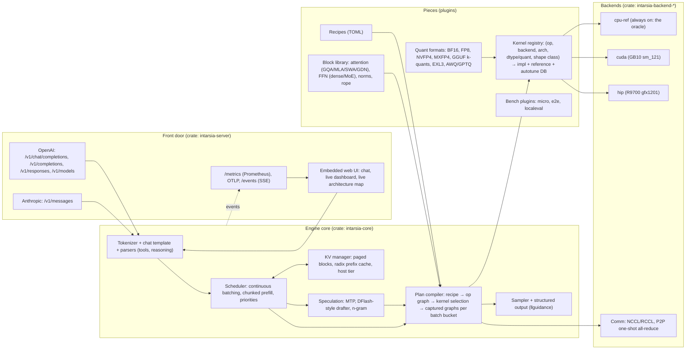

# IntarsiaML architecture plan (v0.1, 2026-10-12)

Intarsia is wood inlay: a picture built from interchangeable, precisely fitted pieces. The engine works the same way. Every op, kernel, quant format, model block, benchmark and API surface is a piece with a contract, and every piece is checked against a reference before it is allowed in.

Research this plan builds on: [AMD R9700 lessons](research/amd-r9700-lessons.md), [Spark / TensorFold / tooling lessons](research/spark-tensorfold-tooling-lessons.md). Decisions are logged in [decisions/](decisions/).

---

## 0. Goals, honest targets, anti-goals

Requirements in priority order (user, 2026-10-12): modular → easy to use → accurate → fast (top 3 per platform) → reproducible → OpenAI/Anthropic APIs → built-in UI/TUI (optional, dark) → metrics → live architecture diagram → Spark → R9700 → TP=X → Intel Arc later.

**What "top 3" means per platform** (the competitor to beat at each phase gate):

| Platform | Current leaders on our boxes | Phase-2 gate | Phase-4 gate |
|---|---|---|---|
| DGX Spark (GB10) | TensorFold (27B EXL3+DFlash2 83 tok/s), vLLM (35B-A3B NVFP4 86-90), llama.cpp, SGLang | beat llama.cpp and vLLM single-stream on the same quant | within 10% of TensorFold |
| R9700 (gfx1201) | native radiance (27B TP=2 207-226), vLLM-radiance (150), llama.cpp Vulkan (MoE 112) | beat llama.cpp Vulkan/HIP | beat vLLM-radiance; radiance is the long-term bar |
| Apple Silicon (dev box) | mlx-serve, MLX-LM, TensorFold-MLX | correctness only | later decision |
| Intel Arc | llama.cpp SYCL | not in scope | not in scope |

Top 3 on R9700 means beating vLLM or llama.cpp, not radiance, until Phase 4. Saying so keeps the target honest.

**Anti-goals** (each one cost a prior project months):
- **No per-family engines.** TensorFold ships a CUDA engine per model family; effort multiplies per model. Here a model is a *recipe* over a shared block library. New code is needed only for a genuinely new block type.
- **No Python in the serving path.** Native radiance starts in 11 s vs 160 s for vLLM at equal or better step time. Python stays in offline tools (golden references, converters).
- **No scope sprawl.** Text LLM inference first. No image, audio or 3D (mlx-serve's burden). Vision encoders are a later block type, not a side product.
- **No kernel enters without passing its reference test.** sm_121 CUTLASS NVFP4 MoE emitting `!!!!!` and a cuDNN FP8 GEMM hanging after 250k steps were both shipped by others.

---

## 1. Language and build

| Layer | Choice | Why |
|---|---|---|
| Host: server, scheduler, KV manager, loaders, metrics, UI server, CLI | **Rust** (stable, edition 2021) | Native speed and startup with memory safety; best ecosystem for this exact stack: `tokenizers` (HF), `safetensors`, `minijinja` (HF chat templates), `llguidance` (structured output), `axum`/`tokio`, `ratatui`, `prometheus-client`, `opentelemetry`, `cudarc` (CUDA driver + NCCL). One static binary per platform. |
| GPU kernels, NVIDIA | **CUDA C++** (+ inline PTX where profiling demands), AOT-compiled to fatbins for `sm_121` (GB10), plus `sm_90/100/120` when hardware appears | Cold JIT compiles take minutes on GB10; AOT removes that. |
| GPU kernels, AMD | **HIP C++** (+ inline GCN/RDNA asm where needed), AOT for `gfx1201` | Same as radiance, which holds the R9700 bar. |
| Shared kernel code | One `ik_portable.h` header that maps CUDA/HIP intrinsics; elementwise, norm, rope, sampling and quant-pack kernels compile from one source for both | Halves the simple-kernel work. GEMM and attention stay arch-specific. |
| Apple (dev) / Arc (later) | Metal / Vulkan or SYCL backends behind the same trait | Not built now; the trait is shaped so they slot in. |
| Offline tools | Python (uv), never imported by the server | Golden logits via HF `transformers`, plotting, converters. |

Rejected: C++ host (radiance proves it works, but modularity, packaging and the server/UI ecosystem are slower to build); Zig host (mlx-serve proves it works, but the ML-adjacent library ecosystem is thin; no `tokenizers`/`llguidance` equivalents); Python host (per-step overhead, startup, container weight); Mojo (tried in `TensorFold-mojo*`, not merged). Assembly is used per hot spot, not as a language choice.

---

## 2. System overview



---

## 3. Core abstractions (the pieces)

### 3.1 Backend trait (minimal on purpose)

```rust
pub trait Backend: Send + Sync {
    fn info(&self) -> DeviceInfo;                       // arch, mem, bandwidth (measured), features
    fn alloc(&self, bytes: usize, kind: MemKind) -> Result<Buffer>;
    fn copy(&self, dst: &Buffer, src: &Buffer, stream: StreamId) -> Result<()>;
    fn launch(&self, k: &LoadedKernel, args: &KernelArgs, stream: StreamId) -> Result<()>;
    fn graph_begin(&self, stream: StreamId) -> Result<()>;
    fn graph_end(&self, stream: StreamId) -> Result<GraphHandle>;
    fn graph_replay(&self, g: &GraphHandle, stream: StreamId) -> Result<()>;
    fn event(&self, stream: StreamId) -> Result<Event>;
    fn comm(&self) -> Option<&dyn Comm>;                 // TP collectives
}
```

Everything else (ops, quant, attention) lives above the trait. A Vulkan or SYCL backend for Arc only has to implement this plus its kernel packs. Backend init applies known-bad-default fixes as data (for example `GPU_MAX_HW_QUEUES=1` on HIP, which removed a permanent 20% slowdown).

### 3.2 Kernel registry: the core of modularity and accuracy

Every **op** (e.g. `matmul`, `rmsnorm_add`, `rope`, `paged_attn_decode`, `paged_attn_verify`, `moe_gate_topk`, `moe_grouped_gemm`, `all_reduce_norm_quant`) has:

1. A **signature**: typed inputs/outputs, layouts, quant format.
2. A **reference implementation** in `cpu-ref` (f32/f64 accumulate). This is the oracle.
3. Any number of **implementations**, each declaring `(backend, arch set, dtype/quant, shape predicate, exactness class)`.

```rust
register_kernel! {
    op: Matmul, name: "nvfp4_gemv_splitk_v1",
    backend: Cuda, arch: [sm_121], weights: Nvfp4, acts: [Bf16, Fp8E4m3],
    when: |s| s.m <= 8 && s.k % 64 == 0,          // shape preconditions are code, checked at plan time
    exact: Exactness::Deterministic,               // or BitExactVsSerial / Tolerance(...)
    tol: Tol { max_abs: 2e-2, rel_l2: 5e-3 },
}
```

Rules:
- **Admission test**: `intarsia kernels test` runs every registered implementation against its reference over a shape sweep (including the recipe's real shapes) and records pass/fail plus error stats. A kernel that fails is unselectable on that host. This catches the "compiles for sm_120 but runs garbage on sm_121" class.
- **Plan-time preconditions**: shape predicates are evaluated when the plan is built, so traps like "MXFP4 GEMM needs per-rank K % 128" fail loudly at load, not as token-0 output.
- **Autotuner**: for each (op, shape bucket) on a host, time the eligible implementations and store the winner in a **tuning DB** keyed by host fingerprint (GPU, driver, toolkit, kernel-pack hash). The DB is a committed lockfile per platform (`tuning/<fingerprint>.toml`) so results reproduce.
- **Exactness modes** (from TensorFold): `fast` (any passing kernel), `deterministic` (fixed reduction order, run-to-run identical), `exact` (multi-row verify equals serial decode bit-for-bit; required for lossless speculation claims). Mode is a server flag and is reported in every result.

### 3.3 Kernel packs (how we get fast quickly)

Writing every kernel from scratch will not converge. Kernels come in **packs** behind the same op signatures:

| Pack | Backends | License | Gives us |
|---|---|---|---|
| `native` (ours) | CUDA, HIP | Apache-2.0 | norms, rope, sampling, small-M GEMV, fused all-reduce+norm+quant, verify attention |
| `ggml` (from llama.cpp) | CUDA, HIP (Vulkan/SYCL later) | MIT | GGUF k-quant MMQ/MMVQ: day-0 coverage of unsloth GGUFs |
| `flashinfer` | CUDA | Apache-2.0 | paged/ragged attention, sampling |
| `cutlass` | CUDA | BSD-3 | NVFP4/FP8 GEMM for prefill on sm_12x |
| `exl3` (ExLlamaV3) | CUDA | MIT | EXL3 trellis GEMV, the current best Spark decode |
| `ck` / `aiter` | HIP | MIT | WMMA GEMM, MoE tiles for gfx1201 (tile tables retuned) |

Rule: **no pack is vendored without a verified license file in-tree** (`LICENSES/`). libr4d (radiance's kernels) has no license file, so we reference its ideas, not its code. Each pack is a git submodule pinned by commit, built AOT, and every kernel it exports passes the admission test like ours.

### 3.4 Quant formats as plugins

```rust
pub trait QuantFormat {
    fn id(&self) -> QuantId;                                  // "nvfp4", "mxfp4", "gguf:q4_k", "exl3:3.0", ...
    fn detect(&self, meta: &WeightMeta) -> bool;              // from safetensors/GGUF metadata
    fn load(&self, src: &TensorSource, dst: &dyn Backend, layout: &Layout) -> Result<QTensor>;
    fn dequant_ref(&self, q: &QTensor) -> Tensor;             // used by the oracle
    fn quantize(&self, t: &Tensor, cfg: &QuantCfg) -> Option<QTensor>;  // optional: on-the-fly RTN
}
```

Adding a quant = implement this trait + register matmul kernels that accept it. The oracle path (`dequant_ref` + reference matmul) works the moment `load` and `dequant_ref` exist, so correctness is testable before any fast kernel is written.

Per-tensor overrides live in the recipe (e.g. drafter stays FP8: MXFP4 RTN dropped drafter acceptance from 2.5 to 2.21 on R9700).

### 3.5 Block library and recipes: adding a model

A **block** is a reusable layer piece with a typed config: `Attention{kind: Gqa|Mla|SlidingWindow|GatedDeltaNet|Mamba2, rope: ..., qk_norm: bool}`, `Ffn{kind: Dense|Moe{experts, top_k, shared, router}}`, `Norm{RmsNorm|LayerNorm, offset}`, `Embedding`, `LmHead{tied}`.

A **recipe** maps a Hugging Face model to blocks:

```toml
# recipes/qwen3.toml
[model]
match.architectures = ["Qwen3ForCausalLM"]
family = "qwen3"
chat_template = "hf"            # use tokenizer_config.json template via minijinja
reasoning_parser = "think-tags"
tool_parser = "hermes"

[layer]                          # applied to every layer i
pattern = ["attn", "ffn"]
attn = { kind = "gqa", q = "model.layers.{i}.self_attn.q_proj", k = "...k_proj", v = "...v_proj",
         o = "...o_proj", q_norm = "...q_norm", k_norm = "...k_norm", rope = "default" }
ffn  = { kind = "dense", act = "silu_glu", gate = "model.layers.{i}.mlp.gate_proj",
         up = "...up_proj", down = "...down_proj" }
norms = { pre_attn = "model.layers.{i}.input_layernorm", pre_ffn = "model.layers.{i}.post_attention_layernorm" }

[top]
embed = "model.embed_tokens"
final_norm = "model.norm"
lm_head = { tensor = "lm_head", tied_to = "model.embed_tokens" }

[defaults]                       # tunables a user can override per deployment
kv_dtype = "fp8_e4m3"
max_batch = 32
```

Hybrid models (Qwen3.5/3.8 GDN + full attention every 4th layer) use `pattern_by_layer` or a `layer_types` key read from `config.json`. `intarsia recipe new <hf-dir>` inspects `config.json` + tensor names, matches the closest existing recipe, writes a draft, and lists unmapped tensors. Most new models in a known family need only a recipe; new block types are the only code.

### 3.6 Plan compiler

`recipe + config + weights + host` → **plan**:
1. Build the op graph for one decode step and one prefill chunk.
2. Apply fusion rules (pattern rewrites in the registry: `add+rmsnorm`, `allreduce+rmsnorm+quant`, `gate+up` concat).
3. For each op, pick the kernel: preconditions → admission pass → tuning DB winner → fallback chain ending at the reference (reference on GPU is never selected silently; it raises an error unless `--allow-slow`).
4. Allocate activations (static arena), KV pool from **measured** free memory (wrong pins OOM'd radiance at startup; GB10 reports no GPU memory via nvidia-smi, so measure via the driver).
5. Capture CUDA/HIP graphs per batch-size bucket for decode and verify steps.

The plan is serializable (`intarsia plan show`) so the UI and humans can see exactly which kernel runs for every op.

---

## 4. Runtime

- **Scheduler**: continuous batching with chunked prefill (adaptive chunk size as in radiance's MoE lane), request priorities (`priority: background`), memory-based admission. A **step watchdog** aborts and restarts the engine loop if the step counter stops advancing for N seconds while work is queued (vLLM's cuDNN FP8 hang on GB10 kept `/metrics` alive while dead).
- **KV**: paged blocks; radix-tree prefix cache keyed by (model, plan hash, token ids); FP8/BF16 KV; optional host-RAM tier on discrete GPUs (refused on GB10 unified memory).
- **Speculation**: pluggable drafters (`mtp`, `dflash` block drafter, `ngram`). Verify uses a split-KV attention kernel for q_len>1 (R9700 lesson: 8930 → 475 µs at 18k). Acceptance per workload is a first-class metric.
- **Sampling**: greedy/temperature/top-k/top-p/min-p/penalties; seeded; `ignore_eos` + `min_tokens` honoured (localeval's speed protocol depends on it); structured output via `llguidance`.
- **Parsers**: tool-call and reasoning parsers are plugins selected by recipe (`hermes`, `qwen3-xml`, `glm`, `deepseek`, `think-tags`, `harmony`). They are the most fragile part of any server, so each has golden fixture tests.

## 5. Parallelism (TP = X)

`Comm` trait with implementations: `nccl` (Spark, two nodes over ConnectX-7), `rccl` (R9700), `p2p_oneshot` (our kernel for small decode messages on PCIe P2P; radiance's one-shot exact bf16 all-reduce costs ~8.6 µs per call). Fusion `all_reduce + rmsnorm + fp8 quant` is a registry pattern. Lossy transports (6-bit rotated, `wht6`) are opt-in, threshold-gated by message size, and must pass the accuracy gate because they change greedy text. TP sharding is declared per block (column/row split) so recipes get TP for free; shape preconditions are checked per rank. Pipeline parallel and TP>2 are designed for, not built now.

## 6. Accuracy system

1. **Op level**: kernel admission tests (3.2).
2. **Model level, golden logits**: `tools/golden.py` (Python, offline) runs HF `transformers` in BF16 on a fixed prompt set (~64 prompts, mixed lengths, chat-templated) and stores top-k logits + full-vocab log-probs for the first N positions. `intarsia accuracy <model>` compares: mean/max KL, top-1 agreement, top-5 overlap, greedy-token match length.
3. **Gates** per quant (defaults, overridable per recipe): BF16 vs HF: top-1 ≥ 99.5%, mean KL ≤ 1e-3; FP8: KL ≤ 5e-3; 4-bit: KL ≤ 3e-2 and benchmark deltas within noise. A failed gate blocks publishing.
4. **Task level**: localeval quality suites (gsm8k, mmlu, ifeval, tool use, long-context) in the deep stage.
5. **Determinism checks**: `deterministic` mode run twice must produce identical tokens; `exact` mode with and without drafting must produce identical tokens.

## 7. Benchmarks and model onboarding

Benchmarks are plugins (`trait BenchPlugin { fn plan(); fn run(); fn report(); }`):
- `micro`: per-op timing vs the byte/FLOP roofline (floor-first profiling, the method that found radiance's 2× gap).
- `e2e`: built-in speed sweep (prompt 128/1K/4K/16K, forced generation length, fresh nonces, median of N, concurrency 1/2/4/8/16), reports decode, prefill, TTFT, and **% of measured bandwidth floor**.
- `localeval`: shells out to `/opt/code/deepeval` (`uv run localeval speed|run`) so results land in the same tables and in unanimis.

**Onboarding pipeline** (`intarsia onboard <hf-repo-or-dir>`), a staged DAG with resumable checkpoints:

| Stage | Target time | Gate |
|---|---|---|
| inspect + recipe draft | 2 min | all tensors mapped |
| golden logits (HF reference, offline) | 10-30 min | — |
| load + accuracy check | 5 min | KL/top-1 gate |
| quick bench (e2e sweep at c=1,4) | 15 min | numbers sane vs floor |
| **publish quick results** (markdown + JSON + unanimis) | 1 min | — |
| deep: quant matrix, long-context 4k/16k/32k, concurrency to 16, localeval quality, spec-decode acceptance by workload | 2-3 h | quality within noise of BF16 |

Quick results publish while deep keeps running. Every result embeds the host fingerprint, plan hash, kernel picks, exactness mode, thinking on/off.

## 8. API surface

OpenAI: `/v1/chat/completions`, `/v1/completions`, `/v1/responses`, `/v1/models`, `/v1/embeddings` (later). Anthropic: `/v1/messages` (streaming events `message_start`/`content_block_*`/`message_delta`, tool use, thinking blocks), `/v1/messages/count_tokens`. Both stream `usage` including `cached_tokens`. Plus `/health`, `/metrics`, `/events`, `/v1/intarsia/plan`.

## 9. UI and TUI

One **embedded web UI** served by the binary (static files compiled in via `rust-embed`, no npm build in the critical path: Preact + htm ESM vendored), disabled with `--no-ui`. Dark mode default with light toggle. Three views:
1. **Chat** (OpenAI endpoint, model/sampling controls, shows thinking, tool calls, per-message tok/s).
2. **Dashboard**: throughput, TTFT, queue, KV use, prefix hit rate, draft acceptance, per-op time share, GPU power/temp.
3. **Live architecture map**: an SVG of the engine (front door → scheduler → KV → plan → kernels → devices → comm), generated from the actual plan, with live metrics overlaid (request flow rates on edges, per-op time share as heat on kernel nodes, KV fill on the pool, all-reduce time on the comm link). Fed by `/events` (SSE, 4-10 Hz).

TUI: `intarsia top` (ratatui) reads the same `/events` stream: one-screen dashboard over SSH.

## 10. Metrics

- **Prometheus** `/metrics`: requests (by status), running/waiting gauges (localeval busy check), monotonic `intarsia_engine_steps_total` (fleetq `WEDGED` detection), tokens prompt/generated/cached, TTFT/ITL/e2e histograms, KV blocks used/free, prefix hit ratio, draft proposed/accepted, per-op time (sampled with events, low overhead), comm time, device mem/power/temp.
- **OTLP** export (optional) for traces per request.
- Shipped: `deploy/grafana/intarsia.json` dashboard + Prometheus scrape snippet for `missioncntrl_/deploy/monitoring/prometheus.yml`.

## 11. Reproducibility and deployment

- **Containers per platform**, built from one `Dockerfile` with build args: `cuda-13-arm64` (Spark), `rocm-7.2-x86_64` (R9700). Toolchain pinned (`rust-toolchain.toml`, CUDA/ROCm base image digests, submodule commits).
- **Host fingerprint** (`intarsia doctor`): GPU, driver, toolkit, kernel versions, measured bandwidth, P2P topology, NCCL/RCCL transport. It checks known pitfalls (sm_121 target, `GPU_MAX_HW_QUEUES`, memlock for ConnectX, THP) and prints fixes.
- **Lockfiles**: `Cargo.lock`, tuning DB per fingerprint, recipe versions. A **run manifest** (JSON) captures binary hash + plan hash + tuning DB hash + model revision so any published number can be re-run with `intarsia replay manifest.json`.
- **Fleet integration**: every start/bench on a fleet box goes through `fleetq`; register the service in `fleetq/deploy/fleet.toml`; localeval target entries in `deepeval/targets.toml`.

## 12. Repository layout

```
crates/
  intarsia-core/          # tensors, ops, registry, plan compiler, scheduler, KV, sampling, spec
  intarsia-backend-cpu/   # reference oracle (always built)
  intarsia-backend-cuda/  # cudarc + AOT fatbins
  intarsia-backend-hip/   # hip bindings + AOT code objects
  intarsia-quant/         # QuantFormat impls
  intarsia-models/        # block library + recipe loader
  intarsia-server/        # axum: OpenAI, Anthropic, metrics, events, UI
  intarsia-bench/         # bench plugins
  intarsia-cli/           # `intarsia` binary: serve, onboard, bench, accuracy, kernels, doctor, top, recipe
kernels/
  common/ik_portable.h
  cuda/  hip/  packs/{ggml,flashinfer,cutlass,exl3,ck}   # submodules, pinned
recipes/                  # *.toml
tuning/                   # <fingerprint>.toml lockfiles
tools/                    # python: golden.py, scribe.py, plots
deploy/                   # Dockerfiles, grafana, fleetq/localeval snippets
docs/                     # ARCHITECTURE, decisions/, research/, recipes/
```

## 13. Phased roadmap with gates

| Phase | Scope | Gate |
|---|---|---|
| **0. Vertical slice (this session)** | Rust workspace; `cpu-ref` + `cuda` backend minimal (BF16 GEMV/GEMM via cuBLASLt, rmsnorm, rope, simple paged attention); Qwen3 recipe; OpenAI + Anthropic streaming; `/metrics`; web UI skeleton with dark mode and architecture map; golden-logit tool; Spark container | Qwen3-8B BF16 on spark1: golden top-1 ≥ 99.5%, both APIs stream, `localeval speed` runs, numbers shown next to vLLM on the same box |
| 1. Fast single-GPU Spark | graphs, fused decode kernels, FP8/NVFP4 quant plugins, flashinfer + cutlass packs, prefix cache, continuous batching | beat vLLM single-stream on Qwen3-8B FP8 and 35B-A3B NVFP4 on spark1 |
| 2. R9700 + MoE + spec | HIP backend, ggml pack (GGUF), MoE blocks, MTP/DFlash drafters, verify attention, onboarding pipeline | beat llama.cpp on R9700 and Spark; quick onboarding < 2 h |
| 3. TP | Comm trait, NCCL 2×Spark, P2P one-shot + RCCL 2×R9700, fused AR+norm+quant | TP=2 speedup ≥ 1.6× decode on R9700 27B |
| 4. Chase the leaders | hybrid GDN blocks, EXL3 pack, small-M kernels, autotuner at scale, Apple/Metal decision | within 10% of TensorFold on Spark; beat vLLM-radiance on R9700 |
| 5. Intel Arc | Vulkan or SYCL backend | when better hardware arrives |

## 14. Risks

1. **Quota/time**: the plan is larger than one week. Mitigation: phases are independently useful; Phase 0 proves every seam.
2. **Kernel pack integration cost** (ggml, flashinfer have their own memory/layout assumptions). Mitigation: adapters per op, admission tests; start with one pack.
3. **R9700 boxes are production** (radiance). Every R9700 run takes radiance down via `fleetq --takes-down radiance` and needs the user's go-ahead.
4. **Spark disk is 95% full** (190 GB free on spark1). Containers and golden-logit files must be pruned.
5. **Exactness vs speed**: exact mode limits kernel choice; keep it a mode.
