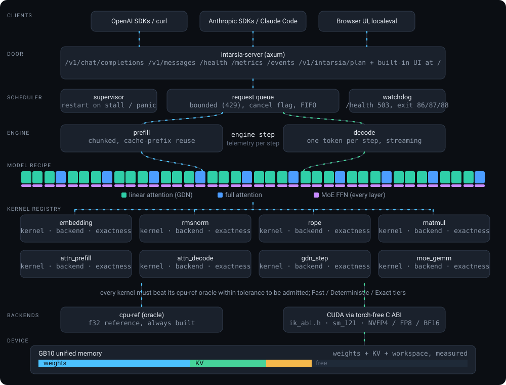
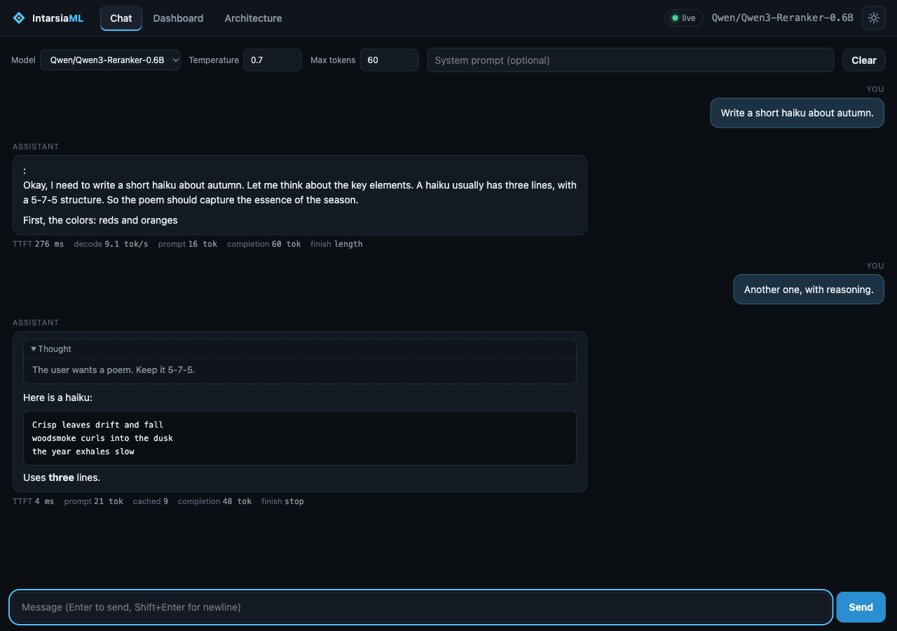
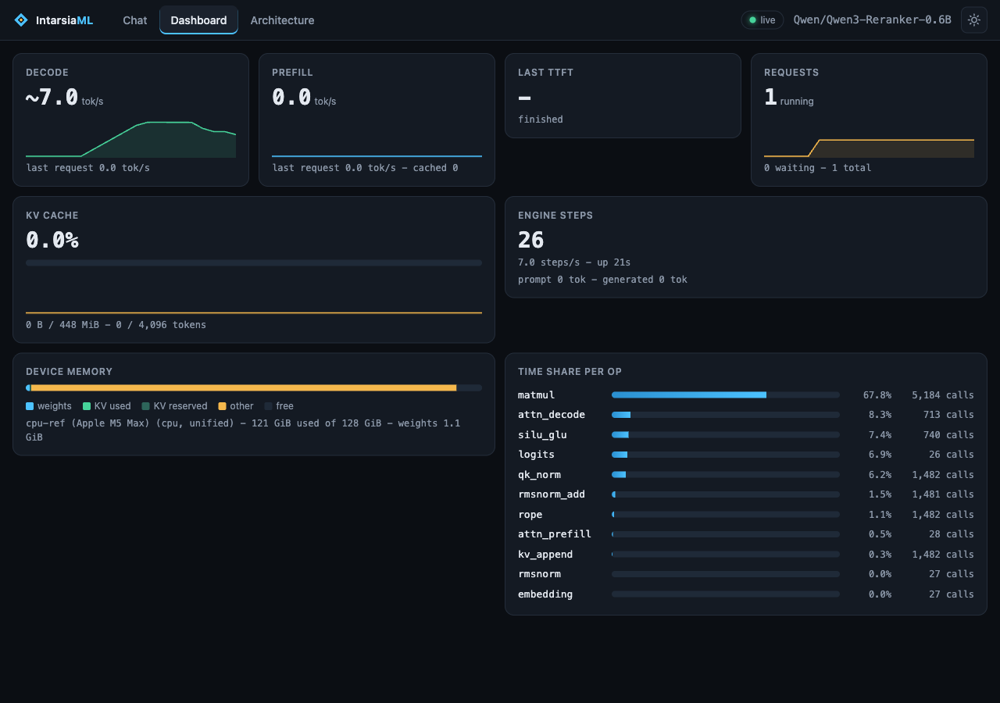
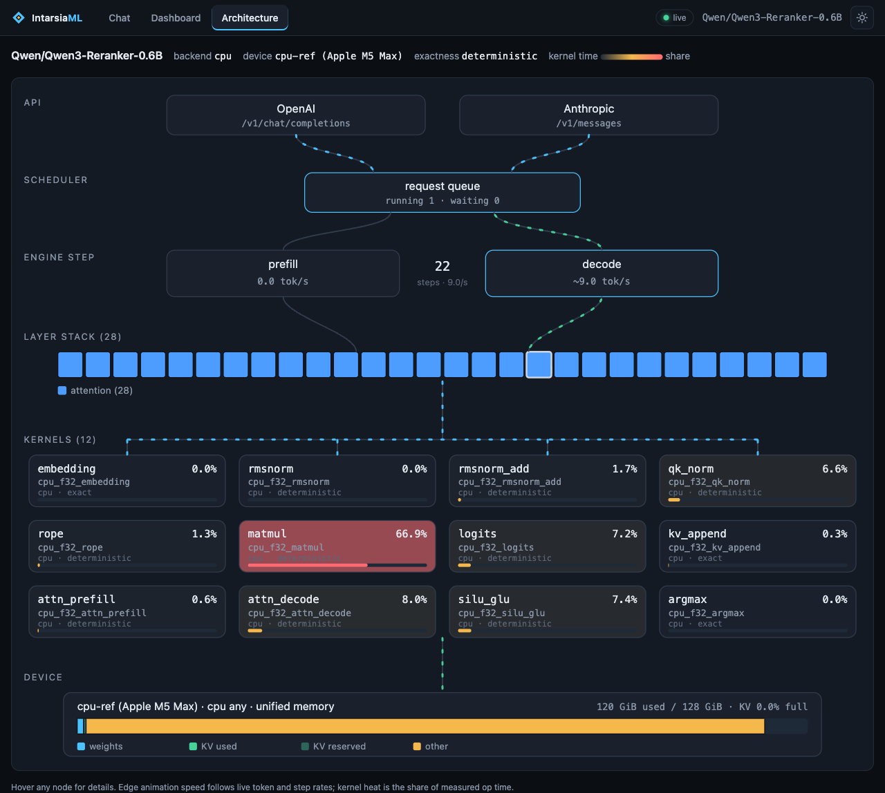

# Architecture diagram

Reading it top to bottom: clients talk to the axum door (OpenAI, Anthropic, `/health`, `/metrics`,
`/events`, the plan endpoint, and the built-in UI). Requests wait in a bounded queue, the engine runs
chunked prefill and one-token decode steps, and the model recipe walks the layer stack (linear attention,
full attention, MoE). Each block calls kernels through the registry, where a kernel is admitted only if it
agrees with the cpu-ref oracle. The CUDA backend sits behind a torch-free C ABI. See `ARCHITECTURE.md` for
the design and `observability.md` for health, the supervisor and the metrics.

The same map, live, is the **Architecture** tab of the built-in UI (served at `/`, turned off with
`intarsia serve --no-ui`). It is drawn from `GET /v1/intarsia/plan` and overlaid with the `/events`
telemetry: edge animation follows token and step rates, kernel nodes are heat-coloured by their share of
measured op time, and the memory bar shows weights, KV fill and free memory.

| Chat | Dashboard | Architecture |
| --- | --- | --- |
|  |  |  |

Light theme: `assets/ui-chat-light.png`, `assets/ui-dashboard-light.png`, `assets/ui-arch-light.png`.
