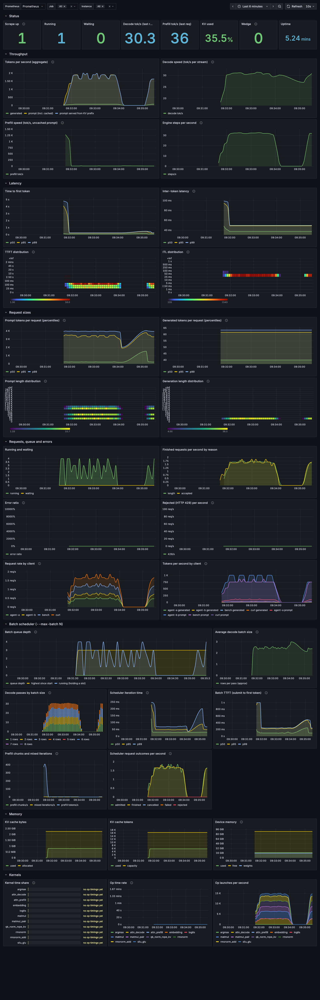

# Observability

Everything the engine reports comes from one struct, `TelemetrySnapshot` (`docs/telemetry.md`).
`intarsia serve` exposes it three ways:

| Surface | Use |
|---|---|
| `GET /metrics` | Prometheus text. Scrape it; the Grafana dashboard in `deploy/observability/` reads it. |
| `GET /events` | SSE stream of the snapshot as JSON, 4-10 Hz. `intarsia top` reads it. |
| `intarsia doctor` | One-shot host fingerprint and pitfall checks (no server needed). |

## `intarsia top`

```sh
intarsia top --url http://spark-4e77:8090      # live
intarsia top --demo                              # synthetic data, no server
intarsia top --demo --exit-after 3               # smoke test, exits by itself
```

Quit with `q`, `Esc` or `Ctrl-C`. It reconnects automatically if the server restarts (status in the
header). Panels, top to bottom:

* header: model, device `[backend arch]`, uptime, connection state, steps/s, request totals by finish
  reason, token totals, weights, device memory;
* sparklines: decode tok/s and prefill tok/s of the last finished request (these update when a
  request finishes), and live engine steps/s;
* gauges: KV bytes, KV tokens, running vs waiting;
* kernel time share: per-op share of the recent time, with ms per launch. Computed from deltas
  between snapshots, with each op's sampled time scaled up by `calls / timed_calls`, then smoothed;
* architecture strip `API -> scheduler -> engine -> kernels -> device`. Each segment is shaded from
  dark slate through amber to red by live load:

  | Segment | Load |
  |---|---|
  | API | `(running + waiting) / 4` |
  | scheduler | 0.35 when a request runs, 0.6-1.0 as the queue grows |
  | engine | steps/s relative to the recent peak |
  | kernels | estimated kernel busy fraction (falls back to the engine load when ops are not timed) |
  | device | KV cache fill |

Operations are only as live as the data: GPU backends time one launch in `profile_every` (default
16), so the kernel shares are statistical and need a few seconds of load to settle.

## Prometheus

Metric names (see `crates/intarsia-server/src/metrics.rs`): `intarsia_engine_steps_total`,
`intarsia_requests_{running,waiting}`, `intarsia_requests_total`,
`intarsia_requests_finished_total{reason}`, `intarsia_tokens_{prompt,generated,cached}_total`,
`intarsia_ttft_seconds` and `intarsia_itl_seconds` (histograms), `intarsia_request_{prompt,generation}_tokens`
(per-request length histograms), `intarsia_source_{requests,tokens}_total{source}` (per client, see below),
`intarsia_kv_bytes_{used,total}`,
`intarsia_kv_tokens_{used,capacity}`, `intarsia_device_memory_{total,free}_bytes`,
`intarsia_weights_bytes`, `intarsia_last_{prefill,decode}_tokens_per_second`,
`intarsia_op_seconds_total{op}`, `intarsia_op_calls_total{op}`, `intarsia_uptime_seconds`,
`intarsia_last_step_timestamp_seconds`, `intarsia_info{model,family,backend,device,...}`.

Robustness metrics: `intarsia_requests_rejected_total` (HTTP 429, queue full),
`intarsia_engine_failed` (1 after a worker panic), `intarsia_engine_no_progress_seconds` (time with
work queued and no engine step; the watchdog input).

Batched engine (`serve --max-batch N`) adds `intarsia_batch_*`. Which gauge counts what: `intarsia_requests_waiting`
(telemetry) and `intarsia_batch_queue_depth` (scheduler) both count requests accepted and not yet given a KV slot,
including those still in the hand-off channel to the scheduler thread, and both are live. They differ only in where a
request enters: `waiting` from `Engine::submit`, so a request that is about to be refused for a full queue is counted
until the refusal; `queue_depth` from the queue reservation, so it never exceeds the bound. `intarsia_requests_running`
(telemetry, live) and `intarsia_batch_running` (scheduler, as of the end of its last iteration) both count requests
holding a slot, prefilling or decoding; an admitted request that has not started prefilling is in `running`, in neither
queue gauge. `intarsia_batch_queue_depth_max` is the highest `queue_depth` seen at a submit. The scheduler also exports
`intarsia_batch_mixed_iterations_total` (iterations that ran a decode phase and a prefill chunk),
`intarsia_batch_requests_{admitted,finished,cancelled,failed,rejected}_total`, and the histograms
`intarsia_batch_{step,chunk_call,ttft,itl}_seconds` (`chunk_call` is the host-side time of the `prefill_chunk` call: a non-final chunk is only enqueued, its GPU time is paid by the next decode step).

vLLM-compatible gauges: `vllm:num_requests_running` and `vllm:num_requests_waiting` carry the same
values as `intarsia_requests_{running,waiting}`. `localeval` decides "is this server busy?" from
exactly these two names (`BUSY_GAUGES` in `/opt/code/deepeval/src/localeval/client.py`), so they must
stay. Do not graph both; use the `intarsia_*` names in dashboards.

## Health, watchdog and supervisor

`GET /health` answers 200 `{"status":"ok"}`, or 503 with `"status":"failed"` (the engine worker
panicked; every new request is refused with 503 too) or `"status":"stalled"` (work is queued or
running but the engine step counter has not moved for `--watchdog-s`, default 60). A hung kernel
keeps `/metrics` and `/health` answering at the HTTP layer, which is why the heartbeat is the step
counter and not the socket. The body also carries `no_progress_s`, `running`, `waiting`, `max_queue`.

`intarsia serve` is a supervisor by default: it starts `intarsia serve --child ...` and restarts it
with doubling backoff (`--restart-backoff-s`, up to 30 s; reset after 60 s of healthy running) when
the child dies. The child exits by itself with a distinct code when its watchdog trips:

| exit code | meaning | supervisor |
|---|---|---|
| 0 | clean shutdown (SIGTERM/Ctrl-C) | exits 0 |
| 2, 78 | bad command line, model or recipe did not load | exits, no restart |
| 86 | watchdog: no engine step for `--watchdog-s` with work queued | restart |
| 87 | engine worker failed (panic) | restart |
| 88 | the supervisor vanished | (child gone) |
| other / signal | crash, OOM kill | restart |

A wedged CUDA context has sticky errors, so a fresh process is the only recovery. SIGTERM to the
supervisor is forwarded to the child (30 s grace, then SIGKILL). `--no-supervisor` runs the server in
the foreground without restarts, for debugging: the watchdog then only turns `/health` to 503.

Debug hooks (worker thread, any build): `INTARSIA_DEBUG_STALL_S=n` sleeps n seconds at the start of
every request (forces a stall); `INTARSIA_DEBUG_PANIC=1` panics there. For testing the watchdog only.

Overload: at most one request runs and `--max-queue` (default 64) wait; the next gets HTTP 429 with
`Retry-After: 1` (`rate_limit_error` in both dialects). A client that disconnects cancels its request:
the engine checks the flag while queued, between prefill chunks and between decode steps, so a
cancelled 16k-token prefill frees the worker after the current chunk. `max_tokens` defaults to what is
left of the context, at most `--default-max-tokens` (4096; 0 = context only).

`GET /v1/intarsia/plan` returns the engine's execution plan (`Engine::plan()`): model, backend,
device, exactness, `layers[]` (index, kind, blocks) and `ops[]` (op, kernel, backend, exactness,
admitted, `calls_per_decode_step`). `null` when the engine has no plan. The `op` strings match the
keys of `ops` in the telemetry snapshot.

## Prometheus, Grafana and alerts (`deploy/observability/`)

```
deploy/observability/
  docker-compose.yml                 Prometheus + Grafana demo against an engine on the host
  prometheus/prometheus.yml          demo scrape config (target host.docker.internal:8090)
  prometheus/scrape-example.yml      scrape jobs to merge into an existing Prometheus
  prometheus/alerts.yml              alert rules (promtool-checked)
  grafana/dashboards/intarsia.json   dark dashboard, uid intarsia-engine
  grafana/provisioning/              datasource and dashboard providers used by the compose file
```

### One-command demo

```sh
intarsia serve --model ~/models/Qwen3-8B --host 0.0.0.0 --port 8090      # any engine; default host is loopback
docker compose -f deploy/observability/docker-compose.yml up -d
open http://localhost:3000        # Grafana (anonymous admin, dark theme), dashboard "IntarsiaML · Engine"
open http://localhost:9090        # Prometheus: Status > Targets, Alerts
docker compose -f deploy/observability/docker-compose.yml down -v
```

`PROM_PORT` and `GRAFANA_PORT` change the host ports. To watch another engine edit the target in
`prometheus/prometheus.yml`. The compose stack is a demo (anonymous admin, 7 days retention): for real use,
import the dashboard into your own Grafana.



### Scrape an existing Prometheus

`intarsia serve` has no auth and serves the default `/metrics` path, so add it as its own job
(`prometheus/scrape-example.yml`):

```yaml
scrape_configs:
  - job_name: intarsia
    metrics_path: /metrics
    scrape_interval: 5s          # the 15s global default also works
    static_configs:
      - targets: ["spark-4e77:8090"]
        labels: { host: spark1 }
```

The server must listen on a reachable interface (`intarsia serve --host 0.0.0.0`; the default is
loopback). It is unauthenticated, so keep it on the LAN or the tailnet. Check with
`curl -s spark-4e77:8090/metrics | head` and, in Prometheus, `up{job="intarsia"}`. The older
Mission Control Prometheus in `/opt/code/missioncntrl_/deploy/monitoring/prometheus.yml` uses a bearer
token and `/api/prometheus` for its own job, which is unrelated.

Fleet Prometheus on `obs` (`obs:9090`, config `/etc/prometheus/prometheus.yml`, Grafana `obs:3000`): see
`docs/results/2026-10-21-m4-observability.md` for the jobs added on 2026-10-21 (radiance, vllm-spark2) and how to revert.

### Dashboard

`grafana/dashboards/intarsia.json` has a datasource variable plus `job` and `instance` filters, so it works with
any Prometheus. Import it (Dashboards, New, Import, upload) or provision it
(`grafana/provisioning/dashboards/intarsia.yml` plus the JSON in `/var/lib/grafana/dashboards`).

| Section | Panels |
|---|---|
| Status | scrape up, running, waiting, last decode/prefill tok/s, KV used, **Wedge**, uptime |
| Throughput | tokens/s (generated, prompt, cached), per-stream decode tok/s, prefill tok/s, engine steps/s |
| Latency | TTFT and ITL p50/p95/p99, TTFT and ITL heatmaps |
| Request sizes | prompt and generation length percentiles and heatmaps |
| Requests, queue and errors | running/waiting, finished by reason, error ratio, 429 rate, request and token rate by client |
| Batch scheduler | queue depth, running, average batch size, decode passes by batch size, iteration time, batch TTFT, prefill chunks and mixed iterations, outcomes |
| Memory | KV bytes and tokens, device memory |
| Kernels | per-op time share, time rate, launch rate (per-phase timings: the ops are the phases) |

Notes on the derived panels:

* **Decode speed** is `rate(itl_count) / rate(itl_sum)`: tokens after the first over decode time, per stream, so it does not
  grow with batch size. The aggregate rate is the tokens/s panel.
* **Prefill speed** is `(rate(prompt) - rate(cached)) / rate(ttft_sum)`. TTFT also contains the first sampled token and,
  with `--max-batch`, the wait behind other prefill chunks, so it is a lower bound on raw prefill speed.
* Counters advance when a request finishes, so rates are smoothed over request length; the "last request" stats and
  `intarsia top` show the most recent request.
* ITL is the per-request mean weighted by token count, not a per-token distribution.
* The batch panels are empty on the single-sequence engine (no `--max-batch`). Average batch size is approximated as
  generated tokens per decode pass.
* Kernel panels need per-op timing (`profile_every`); GPU backends time one launch in N, so shares are statistical.

### Histogram buckets

Long-context reads need buckets near the thresholds, so the token-count histograms are dense around 4k-32k:

| Metric | Buckets |
|---|---|
| `intarsia_request_prompt_tokens`, `intarsia_request_generation_tokens` | 16, 64, 128, 256, 512, 1024, 2048, 4096, 8192, 12288, 16384, 24576, 32768, 65536, 131072, 262144 |
| `intarsia_ttft_seconds` (s) | 0.01 ... 10, 15, 20, 30, 45, 60, 120, 300 |
| `intarsia_itl_seconds` (s) | 0.001 ... 1 |

The coarse "5000, 10000, 20000, 50000" buckets seen in `docs/results/2026-10-19-radiance-context-lengths.md` belong to
radiance's own `vllm:request_prompt_tokens` histogram (a separate engine on tatooine, not part of this repo);
intarsia had no prompt-length histogram before these. A histogram can only be re-bucketed going forward, so history
before this change has no length distribution.

### Client label

Requests are tagged with a `source` label so a dashboard can tell agents, benchmarks and curl apart:

* the `X-Intarsia-Client` request header, else the product token of `User-Agent` (`curl/8.4` becomes `curl`);
* lower-cased, characters other than `[a-z0-9._-]` become `_`, at most 32 characters, missing becomes `unknown`;
* **at most 16 distinct values**; later ones are counted as `other`, so a client that sends a random header per request
  cannot blow up the series count (16 sources x 3 series).

Metrics: `intarsia_source_requests_total{source}` (admitted requests) and
`intarsia_source_tokens_total{source,kind="prompt|generated"}` (finished requests). The latency histograms carry no
source label on purpose (that would multiply every bucket by 16).

### Alerts

`prometheus/alerts.yml` (check with `promtool check rules`):

| Alert | Fires when |
|---|---|
| IntarsiaEngineDown | `up == 0` for 1 m |
| IntarsiaEngineFailed | `intarsia_engine_failed == 1` |
| IntarsiaWedged | work queued or running and no engine step for 1 m (`/metrics` keeps answering with a hung kernel, so `up` is not health) |
| IntarsiaRestarting | uptime reset twice in 15 m |
| IntarsiaQueueSaturated | more than 32 waiting for 2 m (default `--max-queue` is 64; tune) |
| IntarsiaRejectingRequests | any 429 in 5 m |
| IntarsiaKvCacheFull | KV bytes above 95 % for 5 m |
| IntarsiaTtftP95High | TTFT p95 above 10 s for 5 m (long prompts are legitimate: check the prompt-length panel) |
| IntarsiaItlP95High | ITL p95 above 250 ms for 5 m |
| IntarsiaErrorRate | more than 5 % of finished requests end with `reason="error"` for 5 m |

With the supervisor a wedge heals itself within `--watchdog-s` plus a model load, so IntarsiaRestarting is the signal
for a crash loop.

## `intarsia doctor`

```sh
intarsia doctor                    # checklist (backend auto: cuda if compiled in, else cpu)
intarsia doctor --json --out doctor.json
```

Reports OS, kernel, CPU, RAM, GPU (nvidia-smi name, driver, compute capability; `/proc/driver/nvidia/version`;
nvcc / `/usr/local/cuda/version.json`), the backend's `DeviceInfo`, kernel counts per arch, and (with a
real device) measured host-to-device, device-to-host and device-copy bandwidth over a 256 MiB buffer
(`--bw-mib`, 0 skips; device copy counts read plus write bytes). Checks, each with a status
(`ok`/`warn`/`fail`/`info`) and a fix hint where one exists:

* `sm_121_target`: a compute 12.1 GPU (GB10) must have kernels registered for `sm_121`;
* `cuda_toolkit`: CUDA >= 12.9 is needed to compile for sm_121;
* `transparent_hugepages`: `never` slows large weight loads, `madvise` is recommended;
* `disk_free`: warns under 10% or 20 GB, fails under 5 GB (spark1 runs near 95% full);
* `hip_gpu_max_hw_queues`: informational, for the future HIP backend;
* `serve_port`: port 8090 free (8000 is vLLM on spark1).

The CUDA-specific fields only appear on a binary built with `--features cuda`.

## Web UI

`intarsia serve` serves a built-in UI at `/` (assets compiled into the binary from `web/`, no build step, no
CDN). Tabs: Chat (streams `/v1/chat/completions`, collapses `<think>` blocks, per-message TTFT and tok/s),
Dashboard (live `/events`: tok/s sparklines, queue, KV, memory, per-op time share) and Architecture (the engine
map from `/v1/intarsia/plan` with the live overlay; falls back to the telemetry op names when the plan is
null). Dark by default, light via the header toggle or the OS preference. `--no-ui` removes it: `/` and `/ui/*`
then return 404 while the API, `/metrics` and `/events` stay. Token counters are booked when a request ends,
so while one runs the UI shows steps/s as an approximate decode rate (marked `~`).
