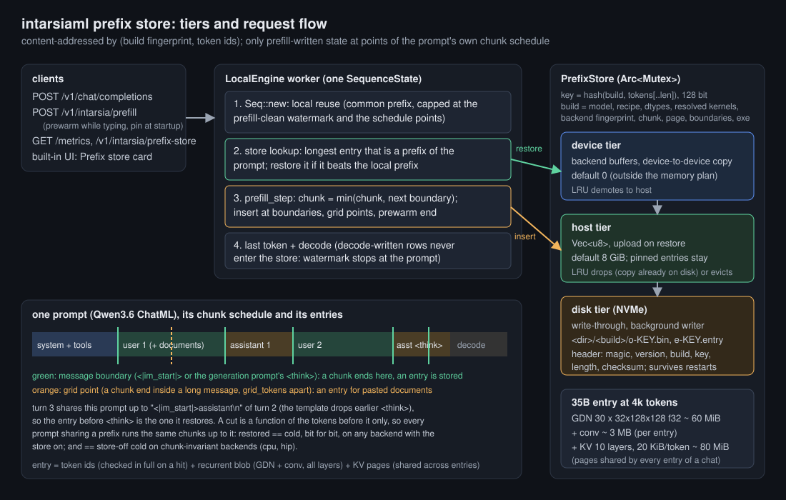

# Lane pc: a content-addressed prefix store ("rainbow table for prompt processing")

Date 2026-10-22/23 (EDT). Branch `lane-pc/prefix-store` off origin/main a92267b0. Machine for every GPU number: endor
(Apple M5 Max, Metal), fleetq slots named next to each number. Decisions: user-approved 22:09 (LOG rows).

**Result in one line:** RESULTS_LINE



## 1. What was there (verified on origin/main a92267b0)

- Reuse was the common prefix with the one `SequenceState` the single-sequence engine holds, then `restorable_len`
  (`crates/intarsia-core/src/engine.rs:897-903` on main). One other request in between (another chat, another tab)
  replaces that state, and the next turn of the first chat prefills from scratch.
- Recurrent snapshots: at most `RECURRENT_SNAPSHOTS = 4`, device memory only (`state.rs:15`, `:159`), taken after every
  prefill chunk and at `plen - 1` (`engine.rs:1145`, `:1153`). A restore falls back to the newest snapshot before the
  divergence point, often 0.
- The Qwen3.6 chat template (`~/models/Qwen3.6-35B-A3B-NVFP4/chat_template.jinja:94-103`, `:147-152`) drops the
  `<think>` block of every assistant turn before the last user query, and the generation prompt ends in
  `<|im_start|>assistant\n<think>\n`. So turn N+1 shares turn N's prompt only up to `<|im_start|>assistant\n`: the
  `plen - 1` snapshot (after `<think>`) is never reusable by the next turn, only by a regenerate.
- Continuous batching refuses recurrent models (`engine/batch.rs:374`); the 35B is served by `LocalEngine`. The store
  is implemented there only; the batched engine refuses `--prefix-store` (`load.rs`).
- Chunk splicing (CacheBlend-style reuse of non-prefix chunks) is not possible for this model: GatedDeltaNet is a
  nonlinear recurrence over the whole prefix and partial RoPE binds K to absolute positions. Only exact prefixes are
  reusable.

## 2. Design

Code: `crates/intarsia-core/src/prefix_store.rs` (store), `engine.rs` (`StorePolicy`, `SeqStore`, `Seq::new`,
`Seq::prefill_step`, `Seq::store_at`), `crates/intarsia-server/src/prefix.rs` (endpoints), `metrics.rs`,
`web/dashboard.js`, `crates/intarsia-bench/src/reuse.rs` (workloads).

**Entries and keys.** An entry is the state after exactly `len` prompt tokens: every attention slot's K/V rows
`0..len` and every recurrent slot (all 30 GatedDeltaNet delta-rule matrices and conv states, one blob). Key = 128-bit
hash of (build fingerprint, `tokens[..len]`, `len`); a hit also compares the stored token ids in full, so a collision
can never restore a wrong state. The build fingerprint hashes: format version, model id, the parsed recipe, dims,
activation and KV dtypes, the resolved kernel plan (`plan_json` ops and layers: which kernel and fusion runs each op),
backend fingerprint, prefill chunk, tail merge, page size, the boundary/header token texts, weights bytes, and the
running executable's size and mtime. Any rebuild, recipe change, other dtype, other chunk or other backend gets a
different fingerprint, so an entry is never restored into a build that did not compute it.

**Pages.** KV is stored in pages of `page` tokens (default 256), each keyed by the hash of the whole prefix up to the
page end. Turn 1, turn 2, turn 3 of a chat (and every conversation sharing a system prompt) share their KV pages; only
the recurrent blob (~63 MiB on the 35B) is per entry. A 35B entry at 4k tokens costs 63 MiB + 80 MiB the first time
and 63 MiB + (new tokens x 20 KiB) after that.

**Tiers.** device (backend buffers, device-to-device copy on restore; default budget 0 because the memory plan already
gave device memory to the KV cache), host (default 8 GiB; `Vec<u8>`, uploaded on restore), disk (`dir=`, write-through
by a background writer thread, so host entries survive a restart of the same build; files `<dir>/<build>/o-KEY.bin` with
magic, format version, build, key, length and checksum in a 48-byte header, and `e-KEY.entry` manifests). LRU per
tier: device objects demote to host, host objects are dropped (their disk copy stays) or evicted, disk objects are
deleted; an entry missing an object is dropped with it. Pinned entries (`--prefix-store-pin FILE` at startup, or
`"pin"` on a prefill call) never leave host memory. A disk object that fails any header check or its checksum is
rejected before the state is touched, the entry is dropped, `rejected_total` counts it and the request prefills cold.
"Pinned host RAM" in the CUDA/HIP sense (page-locked) is not used: the backend trait has no pinned allocator; `upload`
from a plain host buffer is what the engine does today.

**Where entries come from (item 2).** With the store on, `prefill_step` ends a chunk at every *cut*: right after the
first `\n` that follows each `<|im_start|>` (the end of the role header), and right before the second `<|im_start|>`
(where a pinned system prompt ends). Between cuts the plain chunk rule applies (`chunk` rows from the previous cut). An
entry is stored after every message header (the last one of the prompt always, the others when `min` = 32 tokens past
the previous entry), every `grid` = 2048 tokens inside one long message, and at the end of a prewarm. The template check
below decides where the cut must be: the Qwen3.6 template drops the `<think>` block of every assistant turn before the
last user query, and the generation prompt is `<|im_start|>assistant\n<think>\n`; so turn N+1 shares turn N's prompt
exactly up to `<|im_start|>assistant\n` and no further. `crates/intarsia-models/tests/prefix_boundaries_template.rs`
renders 3 turns with the real tokenizer and template (thinking on, thinking off, with tools) and checks the shared prefix
ends on a cut: it does in all 6 transitions (0 tokens lost; e.g. turn 1 -> 2 shares 26 of 28 tokens, with tools 270 of
272).

**What a cut costs (measured on CUDA, section 4).** On the MoE every forward pass reads nearly all expert weights, so a
pass has a fixed cost (about 30 ms on the GB10) whatever its row count. The first version also cut before every
`<|im_start|>` (a 3-token pass per message), kept the engine's `plen - 1` pass, and copied each entry to host memory
inside the prefill (each `download` synchronises the stream, so the GPU idled while the CPU waited): store-on TTFT was
3x store-off. Now: no cut before a message start except message 2; no `plen - 1` pass with the store on (a regenerate
restores the entry after the last header, 2 tokens back); and an insert copies device-to-device into one allocation per
insert, with the device-to-host copies deferred until the request's first token went out (`PrefixStore::settle`; capped
at 1 GiB per request, past it inserts copy to host directly).

**Why every reuse path is bitwise: the schedule rule.** A cut is a function of the tokens before it only, and the
chunks between cuts depend only on the previous cut. So any two prompts that share a prefix run *the same forward passes*
over it, and the state at a shared cut is the same bits in both runs. A request restores only an entry whose length is a
point of its *own* cold schedule (`SeqStore::points`: every chunk end). Restored
then continues with exactly the passes the cold run would run. The same rule caps the engine's local reuse (the state
it already holds) at the prefill-clean watermark (`SequenceState::clean`: decode-written rows never count) and at a
schedule point. Tail merge and 1-row avoidance are not applied with the store on (both depend on the prompt's length,
so they would make a cut depend on later tokens).

What this does *not* give: store-on prefill is bitwise equal to store-off prefill only where prefill is chunk-invariant,
because the store moves chunk boundaries. See section 3: it is not for the hybrid on cpu. `any_cut=1` restores at any
length (no schedule-point filter): only correct for a chunk-invariant build (dense models on cpu, measured).

**Prewarm (item 3).** `POST /v1/intarsia/prefill` takes `messages` (+ `tools`, `chat_template_kwargs`) or a raw `prompt`,
prefills it into the store and generates nothing (`GenRequest::prewarm`). `partial: true` drops the template's trailing
`<|im_end|>\n` and the last `margin` (default 2) tokens, for a message still being typed. `pin: NAME` pins it. Reply:
`prompt_tokens`, `cached_tokens`, `computed_tokens`, `prefill_ms`. Because only schedule points are restored, what a
partial prewarm saves is everything up to the cut after the typed message's header, plus whole chunks of the typed text
(the chunk rule counts from the message start); the last partial chunk of the typed text is recomputed.
`GET /v1/intarsia/prefix-store` returns the counters and the entry list.

**Scope.** Single-sequence engine (`LocalEngine`) only: the batched engine refuses recurrent models anyway
(`engine/batch.rs:374`), and `--prefix-store` with `--max-batch > 1` is refused at load. Tensor parallelism is refused.
Default off (`--prefix-store on` or `INTARSIA_PREFIX_STORE=on`).

## 3. Byte identity

Two different questions, reported separately:

- **(a) restored vs cold, store on**: the guarantee the design gives on every backend.
- **(b) store on vs store off**: only bitwise where prefill is chunk-invariant (the store moves chunk boundaries).

| backend, model | (a) restored vs cold, store on | (b) vs store off | how |
|---|---|---|---|
| cpu, tiny dense (tests/common) | bitwise (logits of every step + ids) | bitwise | `prefix_store.rs`: 2-3 turn chats at chunk 8 and 64, interleaved with another chat; shared prefix after a pinned prewarm |
| cpu, tiny GatedDeltaNet hybrid (`tiny_qwen3_5`, f32) | bitwise | **not bitwise**, ids equal in every case | same tests, plus grid points inside a long message and a restore from the disk tier after an engine restart |
| metal, Qwen3-8B BF16 | METAL8_A | METAL8_B | `prefix_store_metal.rs`, fleetq #4322 |
| metal, Qwen3.6-35B-A3B NVFP4 | METAL35_A | METAL35_B | `prefix_store_metal.rs`, fleetq #4322 |
| cuda (GB10), Qwen3.6-35B-A3B NVFP4 | **bitwise** (48 steps of logits + ids), v1 #4382, v2 #4398, v3 #4406 | not bitwise from step 0 (CUDA prefill is chunk-sensitive), ids equal | `prefix_store_cuda.rs`: turn 1 (1873 tok), an unrelated chat (878), turn 2 (2531 tok) restores 1871 tokens (104 MB in 7 ms) |
| hip | not run | not run | tatooine was held by the hp lane all night; not touched |

**The brief's premise "cpu chunking is bitwise" does not hold for the hybrid.** `hybrid_cpu_prefill_chunk_sensitivity`
runs the same 40 tokens through the tiny hybrid on cpu as 8x5 rows and as 5+19+16 rows: the states (KV + GatedDeltaNet)
differ bitwise. The dense tiny model's are equal (its store-on vs store-off comparison is bitwise). This is the tiny
f32 fixture; the 35B on cpu was not run (too slow for the night), and the recipe's claim that the 35B is chunk-invariant
on HIP (`recipes/qwen3_5_moe.toml` [tuning.hip]) was not re-checked. Consequence: enabling the store is a
numerics-affecting knob for the hybrid, of the same kind as `--prefill-chunk`; it stays default-off everywhere and the PR
stays a draft.

Store mechanics (cpu, `prefix_store.rs`): restored bytes equal captured bytes (KV rows + recurrent); a longer prefix
shares the shorter one's full pages (only 18 new rows + the recurrent blob copied); LRU eviction keeps a pinned entry over
a younger one; the device tier demotes to host and restores bit-exact from there; the disk tier survives a restart and
reports `tier=disk` hits; another build's directory is never read; a flipped byte in an object file is rejected (state
left reset, entry dropped, `rejected_total` = 1); a manifest of another format version is rejected on load; a state of
another slot layout is refused. HTTP (`crates/intarsia-server/tests/prefix_store.rs`): a partial prewarm (159 tokens),
then an unrelated request, then the finished message: 129 of 195 prompt tokens restored (the whole 123-token history
plus the new message's header), answer equal to a cold engine's; `/metrics` and `/v1/intarsia/prefix-store` show it.

`cargo test --workspace` on cpu: 794 passed, 0 failed (fleetq #4315); at the final head (`--release --no-fail-fast`, fleetq #4449) 796 passed, 0 failed, 3 ignored.

## 4. Workloads: TTFT and prefill tokens computed

**Method.** localeval cannot run these workloads: its `speed` mode puts a fresh nonce in front of every prompt to defeat
prefix caches, and it has no multi-turn mode. So `intarsia bench reuse` (`crates/intarsia-bench/src/reuse.rs`) does it,
against the OpenAI endpoint, streaming, `temperature 0`, TTFT = time to the first content or reasoning delta,
`computed = prompt_tokens - usage.prompt_tokens_details.cached_tokens` (the server's own count). Three workloads,
20 requests, 46k prompt tokens per pass:
- **chat**: two conversations (different system prompts), 4 turns each, sent interleaved turn by turn (two users or two
  tabs), thinking on, each user turn quoting ~1500 characters of `tools/prompts/corpus_docs.txt`;
- **agent**: one system prompt and an 8-tool schema (~900 tokens), 4 tasks of 2 requests (task, then a tool result);
- **rag**: the same 3 documents (~5.4k tokens) with 4 different questions.

The first pass runs with the store off and `--max-tokens 512` and records every request (with the live answers as the
history) to `recorded/*.jsonl`; every later pass replays those exact requests with `--max-tokens 64`, so store-on and
store-off runs send byte-identical requests. Each pass gets a fresh server (store empty at start), interleaved on, off,
on, off. Store off is main's behaviour: the engine's own prefix reuse with its one held sequence (it serves the RAG
questions from a snapshot because they arrive back to back).

**CUDA, Qwen3.6-35B-A3B NVFP4, spark2 (GB10), quiet slot.** Four builds in a row, because the first was slower than
store off (section 2, "What a cut costs"):

v1 (cut before every message start, `plen - 1` pass, copies to host inside the prefill), fleetq #4382:

| workload | requests | prompt tok | computed tok off -> on | TTFT total s off -> on | TTFT mean ms off -> on | TTFT median ms off -> on |
|---|---|---|---|---|---|---|
| chat | 8 | 15654 | 15654 -> 6959 (-56 %) | 3.38 -> 10.42 (+208 %) | 423 -> 1302 | 478 -> 1449 |
| agent | 8 | 8574 | 8574 -> 2020 (-76 %) | 2.54 -> 7.71 (+204 %) | 318 -> 964 | 250 -> 760 |
| rag | 4 | 21714 | 9426 -> 9360 (-1 %) | 1.80 -> 5.41 (+201 %) | 450 -> 1354 | 281 -> 814 |
all workloads, TTFT total per rep (s): off [7.8505, 7.5931999999999995], on [24.673599999999997, 22.416600000000003]

v3 (cuts after headers only, no `plen - 1` pass, deferred copies), default `--prefix-store on`, fleetq #4406 (v2, #4398, was within noise of v3):

| workload | requests | prompt tok | computed tok off -> on | TTFT total s off -> on | TTFT mean ms off -> on | TTFT median ms off -> on |
|---|---|---|---|---|---|---|
| chat | 8 | 15654 | 15654 -> 6956 (-56 %) | 3.32 -> 2.69 (-19 %) | 415 -> 337 | 477 -> 319 |
| agent | 8 | 8574 | 8574 -> 2020 (-76 %) | 2.59 -> 2.00 (-23 %) | 324 -> 250 | 251 -> 186 |
| rag | 4 | 21714 | 9426 -> 9360 (-1 %) | 1.81 -> 1.94 (+7 %) | 451 -> 485 | 284 -> 290 |
all workloads, TTFT total per rep (s): off [7.7833, 7.6579], on [6.6869000000000005, 6.5765]

v4 = v3 with `--prefix-store on,roles=assistant` (cuts only after assistant headers and message 2's), fleetq #4420:

| workload | requests | prompt tok | computed tok off -> on | TTFT total s off -> on | TTFT mean ms off -> on | TTFT median ms off -> on |
|---|---|---|---|---|---|---|
| chat | 8 | 15654 | 15654 -> 6959 (-56 %) | 3.31 -> 1.98 (-40 %) | 413 -> 248 | 479 -> 237 |
| agent | 8 | 8574 | 8574 -> 2020 (-76 %) | 2.60 -> 1.77 (-32 %) | 324 -> 221 | 251 -> 133 |
| rag | 4 | 21714 | 9426 -> 9360 (-1 %) | 1.81 -> 1.93 (+7 %) | 452 -> 483 | 283 -> 291 |
all workloads, TTFT total per rep (s): off [7.709], on [5.5923, 5.777100000000001]

Final head `fa9a08e9` (review fixes: page keys, refs, per-object device allocations), every header cut, fleetq #4442
(`raw/cuda-final`, 2 store-on and 2 store-off passes interleaved):

| workload | requests | prompt tok | computed tok off -> on | TTFT total s off -> on | TTFT mean ms off -> on | TTFT median ms off -> on |
|---|---|---|---|---|---|---|
| chat | 8 | 15654 | 15654 -> 6956 (-56 %) | 3.33 -> 2.50 (-25 %) | 416 -> 313 | 477 -> 315 |
| agent | 8 | 8574 | 8574 -> 2020 (-76 %) | 2.56 -> 2.01 (-22 %) | 320 -> 251 | 252 -> 188 |
| rag | 4 | 21714 | 9426 -> 9360 (-1 %) | 1.80 -> 1.97 (+9 %) | 451 -> 491 | 282 -> 293 |

all workloads, TTFT total per rep (s): off [7.64, 7.75], on [6.38, 6.57]

Same head with `roles=assistant`, fleetq #4445 (`raw/cuda-final-assistant`, 2 on, 1 off):

| workload | requests | prompt tok | computed tok off -> on | TTFT total s off -> on | TTFT mean ms off -> on | TTFT median ms off -> on |
|---|---|---|---|---|---|---|
| chat | 8 | 15654 | 15654 -> 6959 (-56 %) | 3.29 -> 2.12 (-36 %) | 411 -> 265 | 478 -> 245 |
| agent | 8 | 8574 | 8574 -> 2020 (-76 %) | 2.52 -> 1.77 (-30 %) | 315 -> 221 | 250 -> 134 |
| rag | 4 | 21714 | 9426 -> 9360 (-1 %) | 1.80 -> 1.93 (+7 %) | 451 -> 483 | 282 -> 293 |

all workloads, TTFT total per rep (s): off [7.61], on [5.86, 5.79]

The final head reproduces v3/v4 within run-to-run spread, and #4442 re-ran the byte-identity test on it
(`raw/cuda-final/ident-35b.out`): restored vs cold, store on, bitwise true.

Per request (v4, chat, 8 requests): TTFT 220, 245, 223, 223, 228, 231, 244, 249 ms with the store, against 428, 166,
279, 285, 479, 486, 616, 626 ms without it. With the store, TTFT stays flat as the conversation grows. Agent follow-ups
take 83-149 ms against 219-260 ms. On RAG the store does not help in this benchmark: store off already reuses 4096 of
5.4k tokens from its held sequence, and the store's extra pass costs 7 %. With RAG questions interleaved between users,
store off would lose that reuse; this run does not measure that case.

**Why TTFT falls less than computed tokens.** On the MoE, a forward pass costs about 30-50 ms on its own, however many
rows it has. Off-runs: 539 tokens 168 ms, 1407 tokens 283 ms, 2372 tokens 483 ms. A restored chat request still runs 2
or 3 passes: the new messages up to the last header, then `<think>\n`. So its TTFT is mostly pass count. Fewer cuts give
fewer passes (v4). The cost is that a prewarm of a half-typed message, or a divergence inside a user message, restores
less. That is why `roles=assistant` is a knob and not the default. Metal: METALW

## 5. Dead-tail skip in non-final chunks

Opt-in, `INTARSIA_PREFILL_SKIP_DEAD=1` (`Model::set_skip_dead`), single sequence, tp=1, not during plan recording. A
prefill chunk that feeds no head (every chunk but the last of a prompt) runs the last layer only up to its cache write:
for a full-attention last layer (the 35B's layer 39, Qwen3-8B's layer 35) the q/k/v projections, q/k norm, RoPE and the
KV write run (`attn_block_kv_only`); the attention core, the output projection, the FFN / MoE and the final norm do
not. A GDN last layer would still run in full (its recurrent state is needed). Nothing reads the skipped values: the next
chunk starts from the KV cache and the recurrent state, never from the previous chunk's hidden state.

Bitwise by construction (the kept ops are the same calls with the same inputs) and by test:
`hybrid_skip_dead_tail_is_bitwise` and `dense_skip_dead_tail_is_bitwise` (`crates/intarsia-models/tests/prefix_store.rs`)
compare every state byte after three non-final chunks, the last chunk's logits and the final state, skip on vs off, on
cpu: equal. Expected gain is small, about one layer in 40 (35B) or 36 (8B) of each non-final chunk's work, so it is
opt-in until it is measured on a GPU. Metal: METALDEAD

## 6. Metrics

`GET /metrics` gains (only when the store is on) `intarsia_prefix_store_{lookups,hits,misses,local_wins}_total`,
`tokens_saved_total`, `bytes_restored_total`, `restore_seconds_total`, `last_restore_seconds`,
`ttft_saved_seconds_total` (restored tokens at the measured cold prefill rate minus restore time; the rate is a moving
average of this server's own cold prefills, exported as `prefill_tokens_per_second`), `inserts_total`,
`insert_bytes_total`, `insert_seconds_total`, `rejected_total`, `entries`, `pinned_entries`, and per tier
(`tier="device|host|disk"`) `tier_hits_total`, `tier_evictions_total`, `tier_objects`, `tier_bytes`,
`tier_budget_bytes`. The same counters are in `/v1/intarsia/telemetry` (`prefix_store`) and in the built-in dashboard
(`web/dashboard.js`): a "Prefix store" card with the hit rate, tokens not recomputed, TTFT saved, last restore time,
and one bar per tier (bytes / budget, hits). `crates/intarsia-server/tests/prefix_store.rs` checks the families appear
and move, and that nothing appears with the store off.

## 7. Cache-affinity routing across two tp=1 replicas (design + prototype)

Prototype only: `docs/results/2026-10-22-pc-prefix-store/scripts/affinity_router.py` (stdlib Python; not run against
GPUs: tatooine was held by the hp lane all night, and this lane never touched it). Its self-test passes
(`python3 -I .../affinity_router.py --self-test`: 4 interleaved conversations x 3 turns over 2 replicas, every
conversation stays on one replica after its first turn, new conversations spread over both, an overloaded owner hands
off).

Design for tatooine's two R9700s (two `intarsia serve --backend hip --prefix-store on` at tp=1, `HIP_VISIBLE_DEVICES`
0 and 1, ports 8091/8092; at tp=1 the 35B NVFP4 fits one 32 GB card at the 29 GB budget the HIP lane uses):

1. **Key on messages, not tokens.** The router hashes every leading run of messages (with the tool schema):
   `h(tools, m0)`, `h(tools, m0, m1)`, ... It needs no tokenizer and matches the store's cut rule (a cut at every
   message start), so "replica R served run k" means "R's store holds the state at that cut", modulo eviction.
2. **Route** to the replica that most recently served the longest run of the request (excluding the new last message),
   unless it has more than `--imbalance` requests in flight above the least-loaded replica; then the least-loaded one
   gets it and learns the runs. A system prompt alone is not affinity (every replica pins it at startup with
   `--prefix-store-pin`), so new conversations spread by load, ties broken by a rendezvous hash of the first user message.
3. **Optional feedback** (not built): replicas could publish their entry keys (`GET /v1/intarsia/prefix-store`) so the
   router stops trusting stale ownership after an eviction; with 8 GiB of host store per replica (~50 entries of a 4k
   chat) the LRU table in the router (4096 runs) is the bigger of the two and staleness only costs a cold prefill.
4. **Why not one replica at tp=2:** tp=2 halves per-token latency but serves one sequence at a time; two tp=1 replicas
   with affinity keep each conversation's state hot on its own card and serve two conversations concurrently. With the
   store, a returning conversation costs one restore (~143 MiB host-to-device at 4k) instead of a full prefill.

What it would take to measure: one fleetq job holding both `tatooine-r9700` and `tatooine-r9700-2`, two servers, the
router in front, `intarsia bench reuse` with the chat workload at 4 conversations, store on/off x router on/round-robin.

## 8. No-op with the store off

NOOP

## 9. Not done, limits, next

Not done or not proven:
- **HIP not run.** tatooine was held by the hp lane all night (never touched), so neither byte identity nor TTFT is
  measured on the R9700s, and the cache-affinity router stays a prototype.
- **Default-on nowhere.** On every GPU backend measured, store-on prefill differs bitwise from store-off from the first
  logit, because the store cuts chunks at message headers and those backends are chunk-sensitive. On the cpu hybrid too
  (section 3). By the brief's rule the store stays opt-in and the PR stays a draft. The tokens agree in every comparison
  run. The cuts would no longer matter if prefill were made chunk-invariant (a fixed internal GDN sub-chunk grid and
  M-independent GEMM tiles). That is a separate project.
- **Page-key fix not proven on cpu.** A reviewer found that a KV page shared between entries could hold rows written by
  a chunk that ended elsewhere. Page keys now include the end of the chunk that wrote them (`page_keys`). The regression
  test `hybrid_partial_prewarm_then_turns_is_bitwise` passes with and without the fix on cpu: there a row's bits depend
  on its chunk's start, not its end. So the fix is defensive for GPU kernels whose tiles depend on the row count.
- **`accuracy --mode prefix-reuse` was not extended.** The engine-level tests above make the same comparison (restored
  vs cold, logits of every step) through the real engine.
- **No pinned (page-locked) host memory.** The backend trait has no pinned allocator. Restores upload from plain host
  memory: 104 MB in 7 ms on the GB10.
- **Known rough edges:**
  - A disk object evicted while its write is still queued can leave an orphan file until the next start.
  - A disk entry rejected on restore also discards the local reuse (the request runs fully cold).
  - The device tier (`device_mb`) is tested on cpu only.
- **Measurements:**
  - TTFT numbers come from one GB10 and one Metal machine, a fresh server per pass, and 2-3 passes. Spread is in the raw
    files.
  - The RAG workload sends its questions back to back, which favours store-off (section 4).


## Reproduce

```bash
# cpu: store mechanics, engine byte identity, dead tail, HTTP, template cuts (fleetq --load cpu on endor)
CARGO_TARGET_DIR=target-test cargo test -p intarsia-models --test prefix_store --test prefix_boundaries_template -- --nocapture
CARGO_TARGET_DIR=target-test cargo test -p intarsia-server --test prefix_store -- --nocapture
python3 -I docs/results/2026-10-22-pc-prefix-store/scripts/affinity_router.py --self-test
# metal (exclusive endor slot): no-op, identity (8B + 35B), reuse workloads, dead tail
FLEETQ_JOB=<id> bash docs/results/2026-10-22-pc-prefix-store/scripts/metal-window.sh all
# a server with the store, a pinned system prompt, a prewarm, the counters
intarsia serve --model M --prefix-store on,host_mb=16384 --prefix-store-pin pins.json
curl -s localhost:8090/v1/intarsia/prefill -d '{"messages":[...],"partial":true}'
curl -s localhost:8090/metrics | grep intarsia_prefix_store
intarsia bench reuse --url http://127.0.0.1:8090 --model m --record DIR   # then --replay DIR, store on vs off
```
